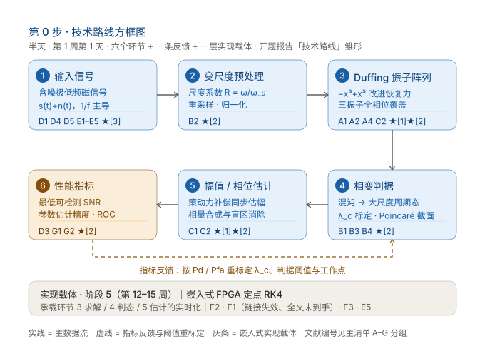

# 第 0 步：技术路线方框图（一页纸地图）

- 对应：[阅读路线.md](阅读路线.md) 第一节「第 0 步（半天，开学前或第 1 周第 1 天）：画一张地图」的过关产出
- 课题：基于混沌振子的极低频磁场微弱信号检测｜学期：第二学期第 1–16 周
- 整理日期：2026-11-13
- 矢量原图：[第0步-技术路线方框图.svg](../assets/第0步-技术路线方框图.svg)（可单独打开、可插入 Word / 开题报告、可无损缩放打印）

> **主链（阅读路线第 0 步原文口径）**：输入（含噪极低频磁信号）→ 变尺度预处理 → Duffing 振子 → 相变判据 → 幅值/相位估计 → 指标。
> 本图在此基础上补了两条线：**指标反馈**（虚线）与**嵌入式实现载体**（底部灰条），因为课题「主要内容」第 4、5 条与「预期目标」都要求落到板上并给出指标，缺了它们技术路线就交不了差。

---

## 零、学到什么程度（第 0 步验收口径）

> 一句话定深度：**只建地图，不修路**。全部内容停留在「知道名词、能讲清关系」，不进入 🅰 精读；不要求推公式、写代码、报数值。

**1. 核心目标**
- 半天内建立一张可自洽复述的全局地图：用六个环节把「含噪极低频磁信号」讲到「两项交付指标」，并说出每环靠哪组文献支撑。
- 明确分工而非求解：知道每个方框「进什么、出什么、归谁做、在第几周」，不要求会算其中任何一步。
- 产出一份「问题清单」：能说清自己还不知道什么、该去哪几篇里找。

**2. 必须理解的概念（到「能说清是什么 / 为什么需要」为止）**
- 六环节的功能与输入→输出：输入信号、变尺度、Duffing 阵列、相变判据、幅相估计、指标。
- 临界混沌态 / 大尺度周期态 / 间歇混合：只作定性区分，记住「临界态会混着规整片段」即可。
- 「相变判据必须可计算」：目测相图为何不够（B1 引言），知道判据不止一种。
- 两条辅助线：指标反馈（阈值按 $P_d/P_{fa}$ 重标定）、嵌入式载体（最终要落到板上）。
- A–G 是文献抽屉标签、★[2] 是母本；**数据流顺序 ≠ 阅读顺序**。
- 两项最终指标的名称与含义：最低可检测 SNR、参数估计精度。

**3. 必须具备的能力**
- 不看资料默画六环主链 + 两条辅助线，每环标出文献分组。
- 对每环用一句话说出「输入 → 输出 → 对应阶段」。
- 3 分钟口头讲清：课题做什么、难在哪、最终交什么。
- 会用 [00-下载索引.md](../文献/00-下载索引.md) 查到某环该读哪几篇；知道 F1 失效、不提供替代链接。
- 能分辨「这是地图，不是最终系统框图」。

**4. 可衡量的完成标准（逐条打勾）**
- □ 方框图已画，或能用 [SVG 原图](../assets/第0步-技术路线方框图.svg) 复述：六环 + 两条线齐全、每环有文献分组。
- □ 三处速读完（★[2] 摘要/引言/结论/图题/小标题、B1 引言、D1 摘要与分类框架），总耗时 ≤ 半天。
- □ 六环逐一口述输入→输出不卡壳；能答「环节 4 为什么不能用眼睛判」。
- □ 能说出两条写作口径：阈值不是普适常数、指标必须连实验条件一起报（**只记规则，不要求会算**）。
- □ 能说清下面第 6 节的「暂不深入」范围，且不把后续周次任务提前记成欠账。
- **验收方式**：对着图给导师或同门讲 3 分钟；或默写六环的输入/输出单，逐条对答案。

**5. 与后续步骤的衔接边界**
- **交出**：一张图（SVG + 本说明页）、六环文献分组索引、一份「待回答问题清单」。
- **不交**：公式、代码、仿真曲线、相图、$\lambda_c$ 数值、SNR 数值、指标数值、参数表。
- **划界**：本步结束 = 能提出正确的问题；一旦开始推方程、跑 RK4、扫阈值、算 $P_d$，就已越过边界，计入后续阶段，不算第 0 步的账。
- 图上环节编号只是交接锚点，本步不对任何环节的内部内容负责。

**6. 只需了解、暂不深入**
- Holmes–Duffing 方程、$-x^3+x^5$ 改进恢复力、势函数与平衡点：知道「有这样一个模型」即可。
- Melnikov / Lyapunov / 0-1 test / 多尺度熵 / Poincaré 判据的推导与实现：只记「判据有多种、各有坑」。
- 变尺度系数 $R$ 的取法、等效采样率、噪声混叠：只记「有这一环、有个坑」。
- 相量合成、相位窗口、120° 阵列覆盖：只记「初相有盲区，阵列用来补」。
- 幅相估计公式、Eq.(17) 一类估幅式：完全不碰。
- SNR 口径、$P_d/P_{fa}$ 计算、ROC、蒙特卡洛次数：只需知道最终要交两项指标。
- FPGA 定点化、位宽、资源、RK4 流水线：只记「最后要落到板上」。
- 0.72/0.73、0.734–0.736、−21 dB 等具体数字：听过即可，不作记忆点、不用于比较。
- 全文精读、参数表、公式推导、代码实现：一律留给后续。

---

## 一、这张图只用半天、只读三处

第 0 步的目的不是推公式，是**建立全局地图**。所以只读摘要、引言、结论、图题、小标题，不碰推导。

| 序 | 读什么 | 只读哪里 | 从图里得到哪个方框 |
|---|---|---|---|
| 1 | ★[2] Yang 等, Sensors 2023 [PDF](../文献/02_Yang_阵列Duffing_MWD_Sensors2023.pdf) | 摘要 / 引言 / 结论 / 全部图题 / 方法节小标题 | 环节 2–6 的整条骨架（母本，一条龙全覆盖） |
| 2 | B1 黄泽徽等, 物理学报 2020 [PDF](../文献/B1_黄泽徽_多尺度熵阈值_物理学报2020.pdf) | **引言**（把相图分割、二分法、0-1、Poincaré 截面、Lyapunov 指数各家判据的优劣数了一遍，是免费的小型综述） | 环节 4「相变判据」为什么必须可计算 |
| 3 | D1 Zhao 等, MST 2021 [PDF](../文献/D1_Zhao_磁异常检测综述_MST2021.pdf) · [详细精读](../04-论文精读/论文精读-D1_磁异常检测综述_MST2021.md)（**超出第 0 步深度，阶段 1 再读**） | 摘要 / 综述分类框架（「基于目标信号」vs「基于噪声」两派） | 环节 1「输入信号」与课题背景定位 |

三篇全文均已入库 ✅，半天的量刚好。**不要在第 0 步碰 A1 的 Melnikov 推导或 G1 的检测理论**——那是阶段 2、阶段 4 的事。

---

## 二、六个方框逐项对照

| 环节 | 输入 → 输出 | 图中标注的文献 | 对应阶段 / 周次 | 该环节的过关产出 |
|---|---|---|---|---|
| **1 输入信号** | 磁通门等传感器输出 → 含噪极低频磁信号 $s(t)+n(t)$ | D1 D4 D5 E1–E5 ★[3] | 阶段 1｜第 1–2 周 | 开题报告「国内外研究现状」约 800 字 + 一段信号/噪声模型假设（先写高斯白噪声 + 1/f 可调模型，待导师给实测数据后替换） |
| **2 变尺度预处理** | 极低频 $\omega_s$ → 尺度系数 $R=\omega/\omega_s$，重采样、归一化到振子固有频率附近 | B2 ★[2] | 阶段 2–3｜第 3–8 周 | 明确 $R$ 的取法与等效采样率；**注意重采样带来的噪声混叠** |
| **3 Duffing 振子阵列** | 预处理后序列 + 内驱策动力 → $x(t)$ 相轨迹 | A1 A2 A4 C2 ★[1]★[2] | 阶段 2｜第 3–5 周 | 单振子 RK4 程序 + 两幅并列相图（混沌态 / 大尺度周期态）+ 可复现参数表 |
| **4 相变判据** | $x(t)$ → 0/1 判态结果；并标定 $\lambda_c$ | B1 B3 B4 ★[2] | 阶段 3｜第 6–8 周 | $\lambda$ 扫描曲线标出临界点 + 判态伪代码 + 初相位盲区区间 |
| **5 幅值 / 相位估计** | 判为「有」之后 → 幅值 $\hat\gamma$、初相 $\hat\theta$ | C1 C2 ★[1]★[2] | 阶段 4｜第 9–11 周 | 蒙特卡洛表：不同 SNR 下的幅值相对误差、相位误差 |
| **6 性能指标** | 全链路 → 最低可检测 SNR、参数估计精度 | D3 G1 G2 ★[2] | 阶段 4 / 6｜第 9–11 周、第 16 周 | $P_d$–SNR 曲线、ROC、误差–SNR 曲线；**指标必须连实验条件一起报** |

> ⚠️ **图上位置是数据流顺序，不是阅读顺序。** 阅读按 [阅读路线.md](阅读路线.md) 的六阶段问题链走（例如 B2 变尺度在阶段 3 才精读，但在数据流上排第 2 环）。编号 A–G 是「资料柜的抽屉标签」，不要按字母顺序读。

### 两个必须写进论文的坑（来自已跑通的复现）

- $\lambda_c$ **不是普适常数**。论文 ★[2] 用 0.72 / 0.73，本机干净数值条件下跃变带落在约 0.734–0.740；换恢复力、步长、噪声带宽、判据都要重标。写论文时把自己标定的阈值和文献值并列，注明条件。
- 工作点存在**三者不可兼得**：离分岔越远越抗噪但越不灵敏、相位覆盖越差。复现里 $\lambda_0=0.720$ 时覆盖率 57.5% / 虚警 0%，0.730 时 97.3% / 2.5%，0.735 时 98.6% / 75%。这正是虚线反馈回路的由来。

详见 [「2」的解读](../02-阶段二/解读-主要内容2-混沌振子建模与临界阈值.md) 与 [notebook 实跑预览](../复现-2-混沌振子建模与临界阈值.html)。

---

## 三、两条不是数据流的线

**虚线 · 指标反馈（环节 6 → 环节 4）**：拿到 $P_d/P_{fa}$、ROC 之后回头重标定 $\lambda_c$、判据阈值与工作点，而不是把阈值当成一次标定就锁死的常数。这是把「最低可检测信噪比」做成可信指标的前提，也是精读文档里 chaos-CFAR 想法的落点。

**底部灰条 · 实现载体（阶段 5，第 12–15 周）**：课题「主要内容」第 5 条要求嵌入式实现。F2 [PDF](../文献/微弱电磁脉冲信号低失真度实时检测的FPGA实现_NormalPdf.pdf) 是最直接的蓝本（最大稳定域实时 RK4、流水线、数据分段并行、FIFO 分离阈值检测与波形恢复）。灰条承载环节 3 的求解、4 的判态、5 的估计三者的定点化。**F1 的下载链接失效且无法打开，全文未到手，不提供替代链接**；F3、E5 需校园网 / 文献传递，状态见 [00-下载索引.md](../文献/00-下载索引.md)。

---

## 四、文献速查（图中编号，仅列已有本地全文的）

| 分组 | 可点开的 PDF |
|---|---|
| ★ 课题自带 | ★[1] [PDF](../文献/01_李远芳_改进强耦合振子_物理学报2024.pdf)｜★[2] [PDF](../文献/02_Yang_阵列Duffing_MWD_Sensors2023.pdf)｜★[3] [PDF](../文献/A_Weak_Anomaly_Signal_Enhancement_Method_Based_on_Vector_Magnetic_Sensor.pdf) |
| A 理论源头 | A5 [PDF](../文献/A5_Gammaitoni_随机共振_RMP1998.pdf)（A1 / A2 / A4 需订阅或纸本，查下载索引） |
| B 判据与变尺度 | B1 [PDF](../文献/B1_黄泽徽_多尺度熵阈值_物理学报2020.pdf)｜B2 [PDF](../文献/B2_基于Duffing振子的变尺度微弱特征信号检测方法研究.pdf)｜B3 [PDF](../文献/B3_Gottwald_0-1混沌检验_2004.pdf)｜B4 [PDF](../文献/aps.64.060503.pdf) |
| C 参数估计 | C1 [PDF](../文献/C1_Wang_混沌振子幅相估计_SignalProcessing2002.pdf)｜C2 [PDF](../文献/C2_曹保锋_强耦合Duffing参数估计_物理学报2019.pdf) |
| D 磁场背景 | D1 [PDF](../文献/D1_Zhao_磁异常检测综述_MST2021.pdf)｜D5 [PDF](../文献/D5_Murzin_超灵敏磁场传感器综述_Sensors2020.pdf)（D4 / D3 未入库） |
| E 导师组 | E4 [PDF](../文献/035035_1_online.pdf) |
| F 嵌入式 | F2 [PDF](../文献/微弱电磁脉冲信号低失真度实时检测的FPGA实现_NormalPdf.pdf)（F1 链接失效且无法打开；F3 / F4 未入库） |
| G 指标与规范 | G2 [PDF](../文献/G2_GBT7714-2015_参考文献著录规则.pdf)（G1 纸本） |

状态图例与完整 30 条清单见 [00-下载索引.md](../文献/00-下载索引.md) 与 [参考资料主清单](参考资料-极低频磁场混沌振子微弱信号检测.md)。著录一律按 GB/T 7714—2015，30 条题录见 [参考文献.bib](../文献/参考文献.bib)。

---

## 五、怎么用这张图

1. **开题报告**：把 [SVG 原图](../assets/第0步-技术路线方框图.svg) 直接拖进 Word（矢量、放大不糊），或在本页打印成 PDF；图下配一句「图中编号为参考文献清单分组，详见第 × 章」。
2. **答辩 / 周报**：按六个方框逐环汇报进度，每个方框对应一个阶段和一个过关产出，不会漏项。
3. **写作时的口径**：环节 6 的两个指标（最低可检测 SNR、参数估计精度）必须连 $P_d/P_{fa}$、噪声带宽、采样率、判据、蒙特卡洛次数一起报；文献里的 −21 / −18 / −12~−16 dB 实验条件互不相同，**不可横向比较**。
4. **图的边界**：这是第 0 步的「地图」，不是最终系统框图。等导师给出实测磁场噪声数据、以及环节 3–5 定点化方案确定后，应把环节 1 的信号模型、环节 4 的判据、灰条里的位宽与资源一并细化重画。
