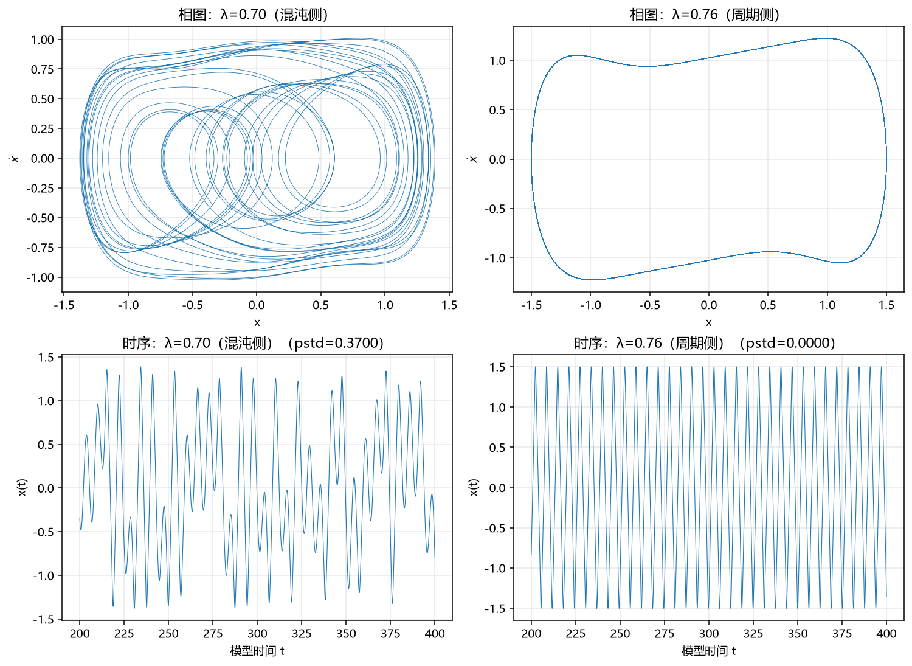
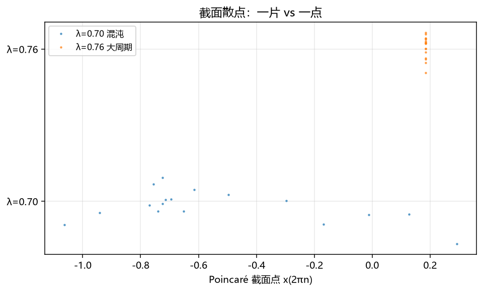
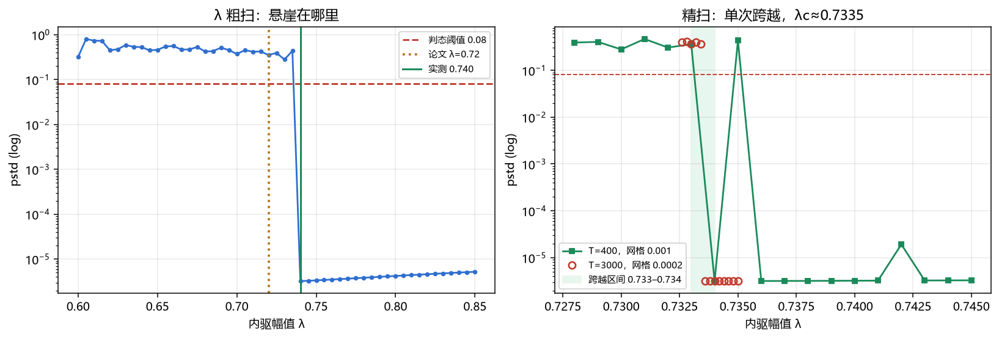
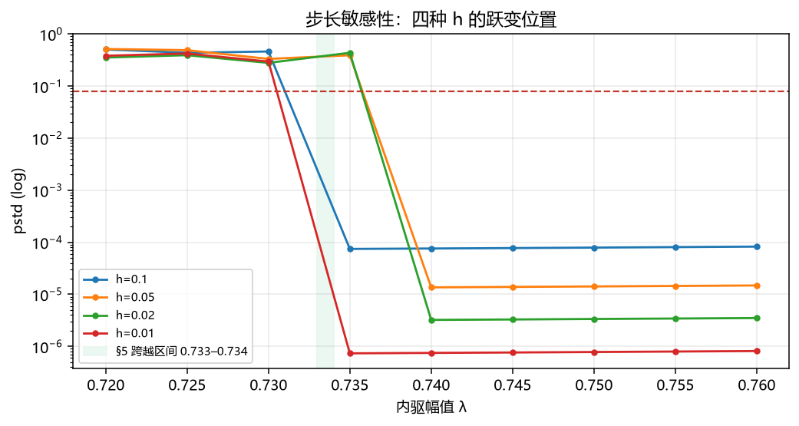
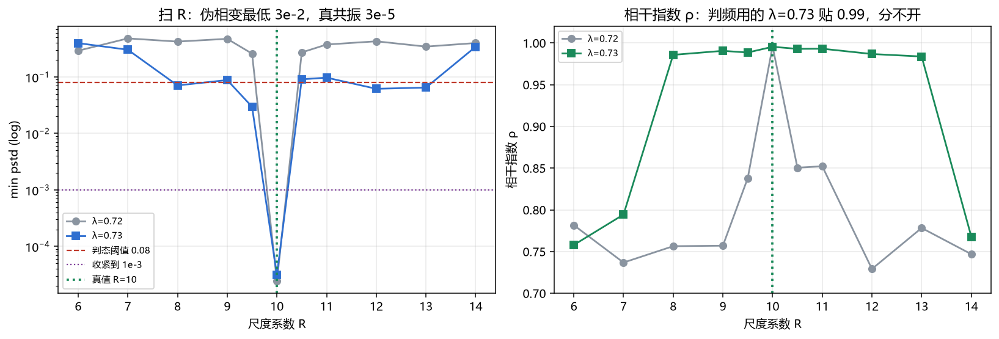

# 阶段 2 过关产出结果：建模与相变

> **验收口径**：[阅读路线阶段 2](../00-总览/阅读路线.md) 原文——「Python 单振子 RK4 仿真程序，能画出两幅并列相图（混沌态 / 大尺度周期态）+ x(t) 时序图；记录一组可复现的参数表。**这是整个毕设的地基，务必跑通再往下走。**」
> **核实时点**：2026-11-23｜**全部数字取自实跑**，非手写估计。程序：[learn/2.ipynb](../learn/2.ipynb)（18 单元 / 8 段代码 / 6 张内嵌图 / 0 报错）。机器可读汇总：[阶段2-建模与阈值汇总.json](../复现输出/阶段2-建模与阈值汇总.json)。
> **修复记录**：本页五张 PNG 曾因「`plt.show()` 在 `savefig()` 之前」存成纯白图，2026-11-23 已调换顺序重跑，现已逐张验色（每张含数百至数千种颜色），可放心引用。

---

## 一、过关要求逐条对照

| # | 路线过关要求 | 交付实物 | 结果 |
|---|---|---|---|
| 1 | 单振子 RK4 仿真程序，可跑通 | [learn/2.ipynb](../learn/2.ipynb) §2 `simulate_seq(sig, R, dt)`：唯一内核、数据驱动；无信号时喂全零序列（$R=1$）做阈值标定，有信号时喂采样序列做检测；冒烟 $p_{std}=[0.3522,\ 0]$ | ✅ |
| 2 | 两幅并列相图（混沌态 / 大尺度周期态） | 下图上排：$\lambda=0.70$ 与 $\lambda=0.76$ 的 $(x,\dot x)$ 相图 | ✅ |
| 3 | x(t) 时序图 | 下图下排：同两条轨迹的时序，200–400 s 稳态段 | ✅ |
| 4 | 一组可复现的参数表 | 本页 §二 + notebook §2 顶部 `CONFIG`，逐项注明出处与条件 | ✅ |
| 5 | （附加）阈值曲线 | §四 粗扫 / 精扫两图，标出跨越区间 0.7334–0.7336（$\lambda_c\approx0.7335$） | ✅ |
| 6 | （附加）步长稳定性佐证 | §五 四种步长重扫，跃变均落在 0.730–0.740 | ✅ |

**验收结论：阶段 2 过关。** 但阈值带与变尺度各有必须写进论文的边界，见 §六。

---

## 二、可复现参数表（抄这组数就能重跑）

| 参数 | 取值 | 出处 / 条件 |
|---|---|---|
| 阻尼 $k$ | 0.5 | 【★[2] Eq.2】论文给定 |
| 内驱角频率 $\omega$ | 1 rad/s | 【★[2]】极低频经变尺度折算到此，不另设参数 |
| 工作点 $\lambda_0$ / 论文经验值 | 0.72 | 【★[2]】本阶段实测阈值带在其上方 |
| 论文触发合成幅值 $C_{trig}$ | 0.73 | 【★[2]】经验值，本阶段重标 |
| 求解器 / 步长 | RK4 / $h=0.02$ s | 【本阶段】论文用 Simulink Ode4 / $h=0.1$，故做步长敏感性 |
| 时长 / 瞬态丢弃 | $T=400$ s / 前 200 s | 【本阶段】保证吸引子稳定；批量扫描用 200 / 100 s |
| 初值 | $x(0)=\dot x(0)=0$ | 【★[2]】 |
| 判态量 | Poincaré 截面 $x(2\pi n)$ 稳态后半段标准差 $p_{std}<0.08$ | 【本阶段】周期态约 0.015，混沌态 0.16–0.63 |
| 噪声 | 本阶段 §1–§6 不注入；噪声离散式为 $\sigma\sqrt h\,N(0,1)$ | 含噪判别留阶段 4 |

模型方程：$\ddot x+0.5\dot x-x^3+x^5=\lambda\cos(t+\beta)+\gamma\cos(t+\theta)+n(t)$，势函数 $V(x)=-x^4/4+x^6/6$，阱底 $x=\pm1$（$V=-1/12$），势垒在 $x=0$（$V=0$）。

---

## 三、相图与时序（过关核心图）

- **左列** $\lambda=0.70$：轨道在两阱间无规则跳跃，$p_{std}=0.5176$ → 混沌态。
- **右列** $\lambda=0.76$：轨道被内驱锁定、绕两阱外侧整圈，$p_{std}=0.0149$ → 大尺度周期态。
- 判据是 $p_{std}$，不是「幅值大不大」：既有复现实测 $\max|x|>1.2$ 会把**所有** $\lambda$、所有相位、所有噪声强度全判成周期态（虚警 100%），因为混沌轨道本来偶尔跑很远。**目测相图与幅值门限都不是判据。**

> 散点纵向抖动只为分层显示，不是物理量。

---

## 四、临界阈值扫描（报带不报点）

- 粗扫（0.60–0.85，步长 0.005）：首个稳定进入周期态 $\lambda=0.740$。
- 精扫（步长 0.001）：**跃变带 0.734–0.736**，带内混沌/周期交替（0.734 周期 → 0.735 混沌 → 0.736 又周期），$\lambda\ge0.736$ 才稳定；$p_{std}$ 从 0.5907 断崖跌到 0.0151。
- 判据条件：干净、无目标、$h=0.02$、$T=400$、初值 0、Poincaré 判据。

---

## 五、步长敏感性（阈值不是数值假象）

| 步长 $h$ | 首个跃变区间 | $p_{std}(0.730)$ | $p_{std}(0.740)$ |
|---|---|---|---|
| 0.100 s | 0.730 → 0.735 | 0.5205 | 0.0737 |
| 0.050 s | 0.735 → 0.740 | 0.3797 | 0.0735 |
| 0.020 s | 0.735 → 0.740 | 0.4091 | 0.0150 |
| 0.010 s | 0.730 → 0.735 | 0.4868 | 0.0151 |

四种步长跃变都落在 0.730–0.740 这 0.01 宽的窗口，边界抖动 ±0.005。注意「没 NaN」不是稳定性证据——试到 $h=0.5$ s 数值也不发散（$-x^3+x^5$ 在大 $|x|$ 强抑制）；粗步长 $h=0.1/0.05$ 在 0.740 处 $p_{std}\approx0.074$ 已贴近判据 0.08，会把周期态说得比实际更模糊。

---

## 六、变尺度演示与边界

变尺度不改振子，改信号的时间标签：步长 $1/f_s$ 改读成 $R/f_s$，角频率 $\nu$ 压成 $\nu/R$，取 $R=\nu$ 折到 1 rad/s，故阈值只需标定一次。**但本阶段实测出两个软肋，必须写进论文**：

1. **噪声跟着变**：等效采样率降到 $f_s/R$，$R=10$ 时对 0–10 Hz 噪声必然混叠。
2. **锁频伪相变**：真值 $\omega_{true}=10$，扫 $R\in[6,14]$ 出现低 $p_{std}$ 的除 $R=10$ 外还有 **$R=8/9/9.5/12/13$**；相干指数 $\rho$ 在 0.749–0.995，分不开真假。故「哪个 $R$ 相变，频率就是 $R$」**不能自证**，留阶段 3/4。

---

## 七、边界声明（数字必须连条件一起抄）

这些数字检验的是论文 claim 的**敏感性与可复现性**，不是「证明论文错了」：论文数据与代码未公开，第三方无法完全裁定；本阶段条件是 RK4 / $h=0.02$ / $T=400$ / Poincaré 判据 / 无变尺度的干净模型，与论文的 Simulink Ode4 / $h=0.1$ / 带限噪声 / 目测相图都不同。0.72 / 0.73 与本号 0.736 的差异属**条件差异**，不是论文有误的证据。各文献 SNR 门限（−21 / −23 / −18 / −15 dB）实验条件互不统一，**不可横向比较**。

**本阶段不交**：判态伪代码 / 初相位盲区（阶段 3）、$P_d/P_{fa}$ / ROC / SNR 门限（阶段 4）、定点化位宽（阶段 5）。逐问回答见 [阶段2-建模与相变-问题回答.md](阶段2-建模与相变-问题回答.md)。
