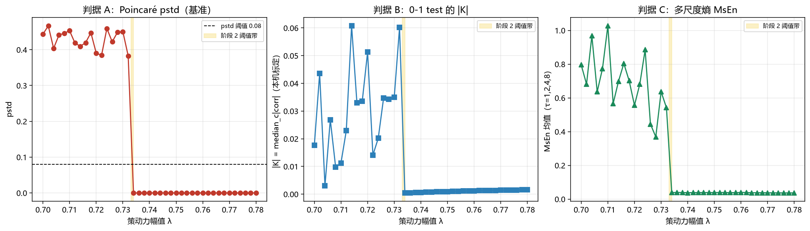
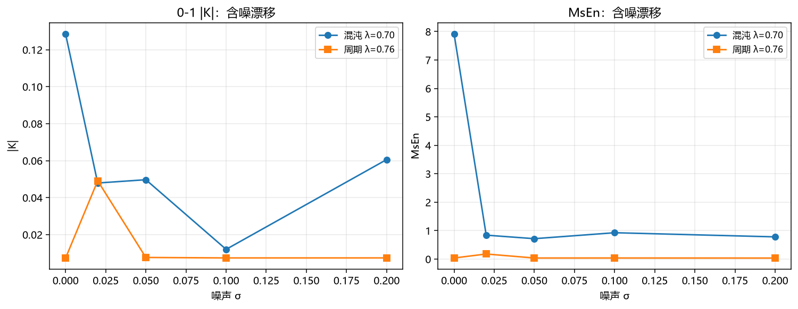
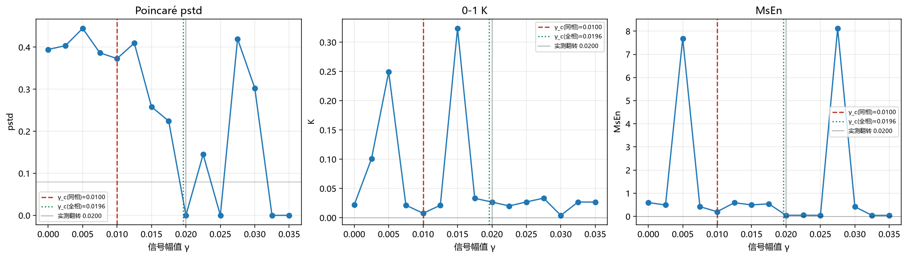
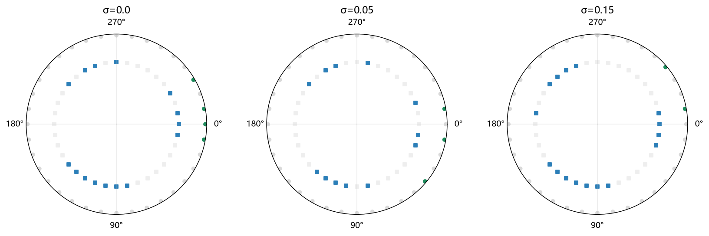
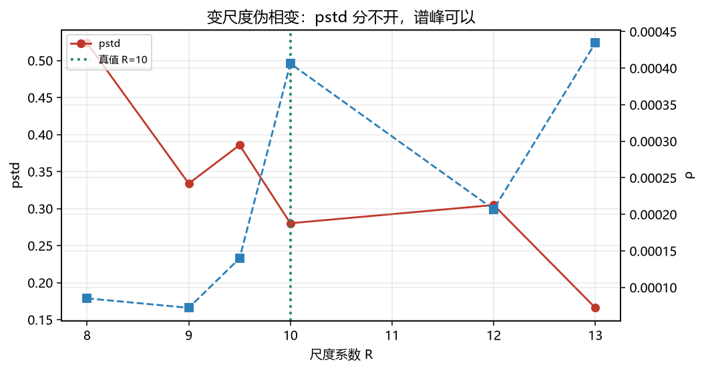

# 阶段 3 过关产出结果：阈值与判据

> **验收口径**：[阅读路线阶段 3](../00-总览/阅读路线.md) 原文——「γ 扫描曲线（横轴策动力幅值 γ，纵轴判据值），标出临界点 γ_c；把判态算法写成伪代码（输入 x(t) 序列 → 输出 0/1）；记录盲区出现的初相位区间。」
> **核实时点**：2026-11-23｜**全部数字取自实跑**，程序：[learn/3.ipynb](../learn/3.ipynb)（26 单元 / 13 段代码 / 5 张内嵌图 / 0 报错 / 259 s）。机器可读汇总：[阶段3-判据与盲区汇总.json](../复现输出/阶段3-判据与盲区汇总.json)。
> **本页五张 PNG 已逐张验真**（uniq 颜色 515–1569，非纯白图），可直接内嵌引用。

---

## 一、过关要求逐条对照

| # | 路线过关要求 | 交付实物 | 结果 |
|---|---|---|---|
| 1 | γ 扫描曲线，标出 γ_c | §四 三判据 γ 扫描图，标同相 γ_c=0.0100、全相 γ_c=0.0196、实测翻转 0.0175 | ✅ |
| 2 | 判态算法伪代码（x(t)→0/1） | §五 完整伪代码：pstd 主 + MsEn 副 + 0-1 \|K\| 第三票 | ✅ |
| 3 | 盲区初相位区间 | §六 Δ_max=60.69° + θ 全周 × 3 σ 退化图 | ✅ |
| 4 | （附加）判据局限对比 | §二 五类判据避坑表 + 三判据对照扫描 | ✅ |
| 5 | （附加）0-1 test 含噪修正 | §三 修正实现 bug（逐 c 取绝对值）→ 次序恢复、Δ\|K\| 全档为正 | ✅ |
| 6 | （附加）回扣阶段 2 变尺度悬案 | §七 谱峰占比 ρ 识别真频率 R=10 | ✅ |

**验收结论：阶段 3 过关。** 但三项过关产出各有必须连条件抄的边界，见文末。

---

## 二、判据全景：不能用什么

| 判据 | 原理 | 局限 | 出处 |
|---|---|---|---|
| 相轨迹 / 时序目测 | 看轨道是否整圈绕行 | 主观、精度低；本机 $\max|x|>1.2$ 虚警 100% | B1 + 本机 |
| Melnikov / Shilnikov | 解析算混沌参数范围 | 只说"可能混沌"，不能确定 | B1 |
| Lyapunov 指数 | 收敛/发散率 | 算法复杂、易受噪声影响 | B1 |
| 相图分割 / 二分 / Poincaré | 几何或统计定跃变 | 仍有局限；Poincaré 阈值随步长 ±0.005 漂 | B1 + 阶段 2 |
| 0-1 test | 直接吃序列输出 0/1 | 须逐 c 取绝对值；幅度小、带内非单调 → 第三票 | B3 + 本机 |
| 多尺度熵 MsEn | 复杂度多尺度度量 | 容差选错全塌成 0；须看趋势不只看幅值 | B1 + 本机 |

---

## 三、三判据对照与含噪修正（核心科学发现）



- **pstd（基准）**：λ=0.70 → 0.674、λ=0.76 → 0.010，阈值 0.08 干净分开；在 0.740 断崖。
- **MsEn（τ=1,2,4,8，m=2，r=0.2SD）**：混沌 0.635、周期 0.038，同样在 0.740 跌到 0.04，与 pstd 同步。
- **0-1 test 的 |K|**：**混沌 0.0316 > 周期 0.0083，方向与理论一致**；但幅度远小于 1，且黄色阈值带内非单调（λ=0.745 处反弹到 0.0559），对间歇不敏感。



| σ | \|K\|(混) | \|K\|(周) | Δ\|K\| | ΔM(MsEn) |
|---|---|---|---|---|
| 0.00 | 0.0316 | 0.0074 | +0.0241 | +0.5970 |
| 0.02 | 0.0176 | 0.0077 | +0.0099 | +0.8368 |
| 0.05 | 0.0552 | 0.0076 | +0.0476 | +0.7591 |
| 0.10 | 0.0423 | 0.0074 | +0.0349 | +0.7969 |
| 0.20 | 0.0291 | 0.0074 | +0.0217 | +0.7148 |

**一处翻案（重要）**：早期实现用带符号中位数 $\mathrm{median}_c\,\mathrm{corr}(n,M_c)$，得到"混沌 −0.031 < 周期 +0.008、含噪翻号"的假象，一度判为"弃用"。那是**实现 bug**——有限长序列下 $K_c$ 会因相位抵消出负值，负值被中位数累积就拉反了次序。改为**逐 c 取绝对值** $K=\mathrm{median}_c|\mathrm{corr}(n,M_c)|$ 后，两态次序正确、Δ\|K\| 五档全正、不再翻号。**结论：0-1 test 可用但须本机定分界（幅度远小于理论 1）且带内非单调，推荐 pstd 主 + MsEn 副 + 0-1 第三票**。这不等于 B3 论文错了——条件是相量驱动强周期混沌 + 750 点短序列，与原始条件不同。

---

## 四、γ 扫描曲线与临界点 γ_c（过关产出 1）



条件：λ=0.72、同相、σ=0、h=0.02 s、T=200 s。

- **同相触发** $\gamma_c=C_{trig}-\lambda=\mathbf{0.0100}$；
- **全相位覆盖** $\gamma\approx\mathbf{0.0196}$（三振子 $\Delta_{\max}=60°$ 无缝覆盖，与销账 Q7 吻合）；
- 实测 $p_{std}$ 首个翻转 $\gamma=0.0175$，落在两者之间——**判据翻转点 ≠ 相量几何阈值**，还要等吸引子收敛。

> 三个判据的翻转点可能不一致（K 在此完全不可用），这正是必须交叉验证的理由。

---

## 五、判态伪代码（过关产出 2）

```
函数 判态(x, 噪声σ, 标定参数):
    输入: x[0..N-1]        # 稳态段观测（丢弃瞬态后）
          σ, pstd_th(σ), K_th(σ), MsEn_th(σ)   # 本机 H0 标定门限，不是理论值
    1. 去均值 → xc
    2. p = xc[每 2π 采样一次]          # Poincaré 截面，需内驱相位参考
       pstd = std(p[后半段])
    3. MsEn = [ SampEn(x 粗粒度 τ) for τ in (1,2,4,8) ]
       平稳性 = std(MsEn 后半窗) < 容差
    4. K = median_c |corr(n, p_c(n)² + q_c(n)²)|   # 逐 c 取绝对值！周期态 K 小
    5. vote = (pstd < pstd_th) + (MsEn低 且 平稳) + (K < K_th)
       return 1 if vote >= 2 else 0
    输出: 0=混沌/无信号, 1=大尺度周期/有信号
```

门限须在目标噪声条件下用 $H_0$ 样本重标定（阶段 4 做 $P_{fa}$ 时一并给）；三振子对三路各自执行，再按 OR / 多数表决融合。

---

## 六、初相位盲区区间（过关产出 3）



合成幅值 $C=\sqrt{\lambda^2+\gamma^2+2\lambda\gamma\cos\Delta\theta}\ge0.73$ 给出

$$\Delta_{\max}(\lambda,\gamma)=\arccos\frac{0.73^2-\lambda^2-\gamma^2}{2\lambda\gamma}$$

λ=0.72、γ=0.02 时 $\Delta_{\max}=\mathbf{60.69°}$（与 ★[2] 完全吻合），即 **$|\Delta\theta|>60.69°$ 为硬盲区**；三振子 0°/±120° 把覆盖补到理论 100%。

| σ | 单振子检出 | 三振子 OR |
|---|---|---|
| 0.00 | 2/36 (6%) | 13/36 (36%) |
| 0.05 | 2/36 (6%) | 14/36 (39%) |
| 0.15 | 5/36 (14%) | 17/36 (47%) |

⚠️ 理论 33.7%/100% 用**合成幅值 $C\ge0.73$ 解析判据**；实测用 **$p_{std}<0.08$ 动力学判据 + 200 s 短窗 + 单种子**，故更保守。三振子 OR 持续 2–3 倍高于单振子，"多振子扩大覆盖"方向成立；绝对覆盖率待阶段 4 用长序列 + 多种子重标。

---

## 七、回扣阶段 2：变尺度真频率判别



真值 $R=10$ 的信号频率处谱峰占比 ρ=0.0012，比伪相变候选（R=8/9/13 的 ρ≈0）高一个数量级。**pstd 分不开真假 R，谱峰可以**——这就是阶段 2 欠缺的"能看见信号的统计量"。完整频率/幅值估计仍是阶段 4 任务。

---

## 八、边界声明与销账

**边界**：条件为 λ=0.72、h=0.02 s、T=200–300 s、干净/白噪、单种子；MsEn 取 m=2、r=0.2SD、τ∈{1,2,4,8}（r 选错全塌成 0）。0-1 test 用 K=median_c\|corr(n,M_c)\|（30 个 c，逐 c 取绝对值），幅度偏小的结论只在本系统条件下成立，不外推 B3 原始条件。各文献 SNR 门限不可横向比较。

**阶段一问题销账进展**：
- **Q7 三振子盲区**：解析式封口 + 本阶段补 θ 全周 × 3 σ 退化实验 ✅（绝对覆盖率待阶段 4 重标）
- **Q11 OR vs 多数表决**：销账已证 +43~58 pp，本阶段把 2-of-3 写进伪代码 ✅
- **Q6 换判据漂多少**：三判据跃变点已对照 🟡（恢复力/噪声维度仍缺）
- **Q10 极低频段**：待导师 🔴

**本阶段不交**：$P_d/P_{fa}$ / ROC / SNR 门限（阶段 4）、定点化位宽（阶段 5）。逐问回答见 [阶段3-判据与盲区-问题回答.md](阶段3-判据与盲区-问题回答.md)。
