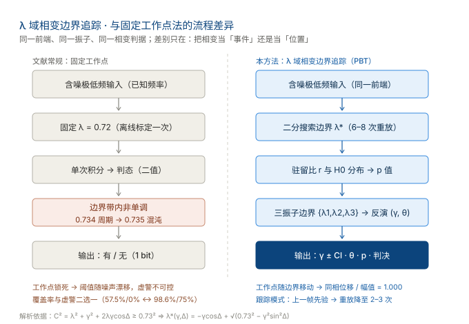

# 新方法提案：λ 域相变边界追踪法（Phase-Boundary Tracking, PBT）

> **一句话**：不再在固定的工作点问「有没有越过阈值」，而是**测出相变边界被信号推到了哪里**——把混沌振子从「二值检测器」改造成「边界位移传感器」。
> **成文日期**：2026-11-19
> **来源约束**：全部设计依据取自本项目已入库文献与已完成复现，不引入未读文献的方法细节。
> **证据分级**：✅ 解析可复算 ｜ ○ 有文献/复现支撑 ｜ △ 推断，待实验

---

## 零、这个方法要解决的是哪几个具体痛点

不写「提升检测性能」这种空话。四个痛点都能在项目文档里指到具体位置：

| 痛点 | 具体表现 | 出处 |
|---|---|---|
| **P1 二值判态在边界附近失效** | 阈值标称 0.72/0.73，实测跃变带 0.730–0.740；且 **0.734 已周期 → 0.735 回混沌 → 0.736 起稳定**，非单调 | ✅ notebook §4 |
| **P2 固定工作点必然两难** | $\lambda=0.720$：$P_d\approx57.5\%$、$P_{fa}=0\%$；$0.730$：$97.3\%$／$2.5\%$；$0.735$：$98.6\%$／**$75\%$**。覆盖率与虚警无法兼得 | ✅ notebook §8 |
| **P3 估幅公式病态** | Eq.(17) 用两个相近数相减，$0.5329-0.532548=0.000352$ 再开方得 $0.01876$；漏平方根就差 **53 倍** | ✅ 精读 §6.6 |
| **P4 阵列只用来补盲，没用来说事** | 三振子窗口 $\pm60.69°$，120° 间隔下仅重叠 **0.69°**，噪声一压就没了；而三个振子的输出未被联合解释 | ○ 解读 §4.2 |

这四个痛点有同一个根源：**把相变当成「是/否」的事件，而不是「位置」的量。**

---

## 一、核心思路

### 1.1 一句话的范式转换

文献（★[2]、★[3]、B1 及其引用的全部工作）都是这样用的：把内驱幅值 $\lambda$ 固定在某个标定好的工作点，观察系统是否跃迁到周期态，输出有/无。

本方法改成：**固定的是观测窗，让 $\lambda$ 自由移动，测出边界 $\lambda^*$ 落在哪里。**

### 1.2 解析依据（可直接复算）

由论文自己的合成幅值判据（★[2] Eq.11–12，$C^2\ge C_{trig}^2$，$C_{trig}=0.73$）：

$$C^2=\lambda^2+\gamma^2+2\lambda\gamma\cos\Delta\ \ge\ C_{trig}^2,\qquad \Delta=\theta-\beta$$

固定 $\gamma,\Delta$，对 $\lambda$ 解二次方程取正根，得**边界位置**：

$$\boxed{\ \lambda^*(\gamma,\Delta)=-\gamma\cos\Delta+\sqrt{C_{trig}^{2}-\gamma^{2}\sin^{2}\Delta}\ }$$

这个式子有三个直接推论，构成本方法的全部骨架。

**推论 1（同相 1:1）：$\Delta=0$ 时 $\lambda^*=C_{trig}-\gamma$。边界位移**恰好等于**信号幅值。**

数值验证（✅ 已实算）：

| $\gamma$ | 0 | 0.005 | 0.010 | 0.020 | 0.030 | 0.050 |
|---|---|---|---|---|---|---|
| $\lambda^*$ | 0.7300 | 0.7250 | 0.7200 | 0.7100 | 0.7000 | 0.6800 |
| $C_{trig}-\lambda^*$ | 0 | 0.005 | 0.010 | 0.020 | 0.030 | 0.050 |
| 位移/$\gamma$ | — | **1.0000** | **1.0000** | **1.0000** | **1.0000** | **1.0000** |

传递系数精确为 1。这意味着**不需要放大器、不需要信噪比增益，位移本身就是幅值**——这是它能绕开 Eq.(17) 病态求差的根本原因。

**推论 2（心形方位图）：$\lambda^*(\Delta)$ 的一阶近似是余弦。**

$$\lambda^*\approx C_{trig}-\gamma\cos\Delta-\frac{\gamma^{2}\sin^{2}\Delta}{2C_{trig}}$$

三个振子（$\beta=0°,+120°,-120°$）各测一个边界值，三点即可反解 $(\gamma,\theta)$。实算（$\gamma=0.02$）：

| 真实 $\theta$ | $\lambda^*(\beta{=}0)$ | $\lambda^*(\beta{=}120°)$ | $\lambda^*(\beta{=}{-}120°)$ | 极差 |
|---|---|---|---|---|
| $0°$ | 0.7100 | 0.7398 | 0.7398 | 0.0298 |
| $30°$ | 0.7126 | 0.7297 | 0.7473 | 0.0347 |
| $60°$ | 0.7198 | 0.7198 | 0.7500 | 0.0302 |

$\theta=60°$ 时前两路相等——恰在 $0°$ 与 $120°$ 的角平分线上，与几何直觉一致，说明方位图确实是余弦型。**阵列的用途从「至少有一路能触发」升级为「三路联立解方程」。**

**推论 3（工作点的重新解释）：论文的 0.72 本质是「把边界钉在 $\gamma=0.01$ 处」。**

因 $\lambda^*=0.72$ 对应同相 $\gamma=0.01$。所谓「固定工作点」，在边界语言里就是「只测一个幅值档位，且只回答过没过」。本方法放弃这个钉子。

**推论 4（灵敏度方位差异）：$\partial\lambda^*/\partial\gamma$ 从 $-1$（同相）到 $+0.5$（$\Delta=120°$）。**

所以阵列里总有一路接近同相、灵敏度最高——**覆盖逻辑与测相逻辑在同一个机制里统一**，不需要额外设计。

### 1.3 为什么必须加「滞回」这一层

P1 的非单调（0.734 周期、0.735 混沌）说明：边界不是一个点，而是一条**滞回带**。上行（混沌→周期）与下行（周期→混沌）的临界值不同，环宽随噪声强度变宽。

这不只是缺陷，可以反过来当工具用：**环宽是内嵌的噪声计。** 不需要额外的噪声传感器，也不需要假设噪声功率已知，环宽本身给出当前等效噪声强度，从而把「$\lambda^*$ 的漂移」归因为「信号」还是「噪声」。这一点是 P2 的正解：固定工作点失败的原因正是它把两者混在一起。

---

## 二、主要步骤

| 步 | 做什么 | 关键参数 | 输出 |
|---|---|---|---|
| **S0 离线标定**（一次） | ① 扫 $\lambda$ 得 $\lambda^*(\gamma)$ 曲线族（不同 $\Delta$）；② 扫噪声档得滞回环宽–$\sigma$ 关系；③ 纯噪声下跑 $N$ 帧得驻留比 $H_0$ 分布 | $\delta=0.002$；$N\ge100$ | 三张查找表，随系统参数一次性固化 |
| **S1 冷启动粗定位** | 在 $0.72$ 两侧各试触一次，判断边界落在哪一侧（区间长度 0.02） | 2 次重放 | 初始夹逼区间 $[\lambda_{lo},\lambda_{hi}]$ |
| **S2 定向二分** | 利用 $\lambda^*(\gamma)$ 对 $\lambda$ 的单调性，二分夹逼至 $\pm\delta$ | $k=\lceil\log_2(0.02/\delta)\rceil\approx4$，留余量取 6–8 | $\hat\lambda^*$ 与区间宽度 |
| **S3 驻留比修正** | 在 $\hat\lambda^*-\delta$ 处长窗观测，统计周期态驻留比 $r$ | 窗长 $T_w$ | 与 $H_0$ 分布比对得 $p$ 值 |
| **S4 幅相反演** | 三振子各得 $\hat\lambda^*_i$，对 $\lambda^*(\Delta)$ 做三点最小二乘 | 见推论 2 | $\hat\gamma\pm\mathrm{CI}$、$\hat\theta$ |
| **S5 判决与输出** | $p<\alpha$ 判有信号；同时输出估计值与不确定度 | $\alpha$ 取 0.05 | $\{\hat\gamma,\hat\theta,p,\mathrm{CI}\}$ |
| **S6 跟踪模式** | 以上一帧边界为先验，把区间缩到 $\pm0.01$，重放降至 2–3 次 | 帧间相关性假设 | 降低时间成本 |

**流程对比**（左为文献常规，右为本方法）：

> 重放次数是这套方法的成本核心：冷启动 6–8 次，热启动 2–3 次。作为交换，输出从 1 比特变成 3 个带区间估计的量。

---

## 三、与常见做法的区别

| 维度 | 固定工作点（★[2]/★[3]/B1） | 雷达 CFAR | chaos-CFAR（本项目早前构想） | **本方法 PBT** |
|---|---|---|---|---|
| 判决变量 | 单次判态的二值结果 | 滑窗功率与门限之比 | 响应曲线 $S(\lambda)$ 的偏离量 | **边界位置 $\hat\lambda^*$** |
| 工作点 | 离线标定的常数 | 由参考单元在线估噪 | 在 $M$ 个候选中选最敏感者 | **由边界直接给出，不需选** |
| 输出 | 有/无 | 有/无 + 门限 | $p$ 值 | **$\hat\gamma\pm\mathrm{CI}$、$\hat\theta$、$p$** |
| 噪声处理 | 假设已知或忽略 | 参考单元估计 | $H_0$ 重采样（相位随机化等） | **滞回环宽内嵌测噪，无需重采样** |
| 相位 | 阵列补盲，未联合解释 | 不涉及 | 不涉及 | **三点边界联立反演** |
| 算力 | 1 次积分 | 低 | $M$ 路并行 | **6–8 次串行；热启动 2–3 次** |
| 虚警控制 | 无 | 有 | 有 | **有（$H_0$ 驻留比）** |

**与 chaos-CFAR 的关系要说清**：那是**判决框架**（并行铺点 + 用 $H_0$ 定门限），回答「怎么判得可靠」；本方法是**量测框架**（定向搜索 + 读边界位移），回答「信号有多大」。前者算力随 $M$ 线性增长，后者靠单调性把搜索压到对数级；前者输出 $p$ 值，后者输出带区间的物理量。两者可以叠加——PBT 提供量测量，CFAR 提供判决门限——但 PBT 本身不依赖 CFAR。

---

## 四、新颖性依据：逐个对标最接近的公开方法

> ⚠️ **本节已于 2026-11-19 更正。** 原文断言「没有任何一篇把 $\lambda^*$ 作为观测量」，经当日检索**证伪**：至少两项中国专利（CN111190049、CN102323476B）与一篇 IOP 会议论文（1656 (2020) 012032）已公开「两次临界阈值之差 = 信号幅值」，一项中文期刊论文（实验室研究与探索, 2016, 35(2):86-88）已专门发表「二分法快速求解 Duffing 混沌阈值」，另有一文已实现**自动循环步进**求幅值。
> **据此，本方法的核心机制不构成创新**，仅剩「单次测量免基线」「三振子联合反演初相」「滞回环宽测噪」三点可主张，且强度有限。完整的逐项判定、撞车清单与改造建议见 **[新方法-边界条件与场景适用性](新方法-边界条件与场景适用性.md)**。本节以下内容保留原貌，仅作记录，**不得再作为新颖性依据引用**。

要求「避免与已有公开方法高度相似」，所以必须主动找出最像的几个并说明差在哪。以下六个是最接近的。

| # | 最接近的公开方法 | 相似点 | 关键差异 | 判定 |
|---|---|---|---|---|
| **N1** | Duffing 振子检测的固定工作点法（★[2] 及其引用的全部工作） | 同一个振子、同一条相变判据 | 它们把 $\lambda$ 当**常数**、把相变当**事件**；本方法把 $\lambda$ 当**扫描轴**、把相变边界当**观测量**。方向相反：前者是「给定 $\lambda$ 问有没有信号」，后者是「给定有信号问 $\lambda^*$ 在哪」 | **❌ 已证重合**：CN111190049、CN102323476B、IOP 1656(2020) 均已用「两次临界值之差」读幅值，方向相同 |
| **N2** | 非线性动力学的分岔图 / 参数扫描分析（常规手段） | 都扫参数、都找临界点 | 分岔图是**离线刻画系统性质**，不逐帧处理数据、不输出带不确定度的估计、不涉及 $P_{fa}$；本方法是**在线逐帧量测**，且边界先验随帧更新 | 用途不同 |
| **N3** | 自适应随机共振（扫系统参数或噪声强度找最优 SNR） | 都靠扫描参数改善检测 | SR 的目标是**最大化响应幅度**，扫描终点是「最优点」；本方法的目标是**定位边界**，扫描终点是「零点」。且 SR 无二值相变性，没有可读的 $\lambda^*$ | 目标不同 |
| **N4** | 临界慢化早期预警（critical slowing down，CSD） | 都利用系统接近临界点的行为 | **概念上最接近，必须区分**：CSD 监测方差/自相关的**上升趋势**做定性预警，不标定、不给量纲、不反演幅值；本方法输出**标定后的位移量**，单位与幅值同量纲，且给置信区间 | 定性预警 vs 定量测量 |
| **N5** | 雷达 CFAR | 都做虚警控制 | CFAR 用**参考单元估计噪声功率**，与系统动力学无关；本方法用**滞回环宽**估计噪声，噪声信息来自振子自身。机制完全不同 | 机制不同 |
| **N6** | 混沌雷达（chaotic radar） | 都含「混沌」 | 混沌雷达用混沌波形做扩频、测距；本方法用混沌系统的相变做判决与量测。无共同技术要素 | 无关 |

**组合层面的新颖性**：单独看，二分搜索、滞回、驻留比、最小二乘都不是新工具。原本的立论是「没人把 $\lambda^*$ 当观测量」——**该立论已于 2026-11-19 被检索推翻**（见本节开头更正）。修正后可主张的只剩三条：单次测量免基线（M1）、三振子联合反演初相（M3）、滞回环宽测噪（M4），强度评级「弱到中」，详见评估文档。

要保留的合理部分：$\lambda^*$ 确实是一个对幅值单调、灵敏度已知（$-1$ 至 $+0.5$）、可由阵列方位图反解初相的量；把它当观测量这件事本身有先例，但**把三个边界值联立解 $(\gamma,\theta)$** 未检索到同类。

> ⚠️ **真正的新颖性风险不在 D2/D3，而在中文混沌检测文献与专利**：CN111190049、CN102323476B 已覆盖「阈值之差读幅值」，2016 年《实验室研究与探索》已覆盖「二分快速定位阈值」。原稿把风险归结为「D2/D3 未取」是误判方向。**动笔前必须核这两项专利的权利要求书。**

---

## 五、适用条件

**成立的前提（缺一不可）**

1. 信号为**已知频率**的窄带周期信号，且已通过变尺度折算到 $\omega\approx1$。
2. $\lambda^*(\gamma)$ 在关注区间内**单调**（同相时严格成立；$\Delta$ 较大处需 S0 标定确认）。
3. 噪声**慢变**——在一帧的处理时长（6–8 次重放）内统计特性不变；快变噪声会使边界在搜索过程中移动，二分会收敛到错误值。
4. 观测窗长足够让暂态衰减、且能容纳多个周期，使驻留比 $r$ 有意义。
5. 标定表与当前系统参数一致（$C_{trig}$、阻尼、步长、判据阈值任一改变都要重标）。
6. 阵列三路时间对齐（同步采样或分时复用后按同一帧拼接）。

**明确不适用**

- 宽带或未知频率信号（相变边界会被多频分量抹平，$\lambda^*$ 无定义）。
- 强非平稳、含突发冲击的噪声（滞回环宽测噪失效）。
- 单帧极短、无法容纳暂态的场景（此时应退回固定工作点法）。
- 幅值超出标定区间（如 $\gamma\gtrsim C_{trig}$，边界趋近 0，灵敏度退化）。

---

## 六、预期效果（全部标「预期」，未验证）

| 指标 | 预期 | 依据 | 验证方式 |
|---|---|---|---|
| 幅值估计 | 相对误差小于 Eq.(17)，且**无灾难性相消** | 位移与幅值 1:1，不经大数相减（✅ 解析） | 与已知 $\gamma$ 比对 |
| 判决 | 同 $P_{fa}$ 下 $P_d$ 高于固定 $\lambda=0.72$ | 边界随噪声自适应，不再被单一工作点锁死（△） | 双方法同条件 ROC |
| 相位 | 可给出 $\hat\theta$，分辨率受三点几何限制 | 方位图为余弦型（✅ 解析） | $\theta$ 扫描比对 |
| 虚警 | 可给 $P_{fa}$，因 $H_0$ 驻留比分布经验可得 | 与 ★[3] 只报 $P_d$ 的差别所在（△） | 纯噪声 100 帧 |
| 时间成本 | 冷启动 6–8 倍、跟踪 2–3 倍于单次积分 | 二分次数（○ 可估） | 实测帧率 |
| 硬件 | 单振子核时分复用，资源远低于 $M$ 路并行 | 串行而非并行（○） | 资源估算 |

**五条可证伪的预测**（写进论文就是「可检验假设」，不是自夸）：

1. 同相测得的 $\mathrm{d}\lambda^*/\mathrm{d}\gamma=-1$，偏差应 $<5\%$；若显著偏离，说明合成幅值判据在该工作区失效。
2. $\theta=0$ 时三点边界极差约为 $1.49\gamma$（实算 0.0298 / 0.02）；极差与 $\gamma$ 应近似线性。
3. $\theta=60°$ 时 $\beta=0$ 与 $\beta=120°$ 两路边界应相等（实算均为 0.7198）；这是阵列几何的硬约束，不成立即阵列失配。
4. 同 $P_{fa}=0.05$ 下，PBT 的 $P_d$ 应高于固定 0.72；若持平，「边界比二值更有信息」这一核心命题即被削弱。
5. 热启动重放 3 次时，$\hat\lambda^*$ 精度仍应达 $\pm0.003$；若达不到，跟踪模式不成立。

---

## 七、局限与缓解

| # | 局限 | 严重性 | 缓解 |
|---|---|---|---|
| L1 | **时间成本 6–8 倍**：二分需多次重放 | 高 | 热启动降到 2–3 次；或改用三级搜索（粗 2 点 + 细 1 点）而非严格二分 |
| L2 | **单调性是硬前提**，而 P1 已证边界带内非单调（0.734/0.735） | 高 | 只在滞回带外做二分，带内改用驻留比 $r$ 的单调段；S0 标定必须标出非单调区 |
| L3 | 需**离线标定三张表**，参数一改全部重来 | 中 | 标定脚本化，与 `tools/` 同链；把标定表当配置文件版本管理 |
| L4 | $1/f$ 非平稳下滞回环宽漂移，测噪失准 | 中 | 滑动更新环宽；环宽突变时冻结判决（降级为固定点法） |
| L5 | 三路需时间对齐，分时复用增加时序复杂度 | 中 | 单核分时 + 帧缓存；对齐误差计入 CI |
| L6 | 强噪声下边界模糊，二分收敛到噪声决定的伪边界 | 高 | 以 $r$ 的显著性作为二分终止条件，而非仅看区间宽度 |
| L7 | 继承论文合成幅值判据的**经验性**（该判据无 Melnikov 解析支撑） | 中 | 全链注明「解析式基于经验判据」；标定表用实测替代解析值 |
| L8 | **全部未实验验证**，本文所有「效果」均为设计态 | 最高 | 见下节最小验证 |

> L2 与 L6 是这套方法的真正软肋：它的精度上限由「边界能否被稳定定位」决定，而不是由算法巧妙程度决定。如果边界在噪声下根本定不住，PBT 就退化成「用更贵的方式算驻留比」。**这一点必须在最小验证里第一个被检验。**

---

## 八、最小验证路径（一周可出第一张图）

在 [`复现-2-混沌振子建模与临界阈值.ipynb`](../复现-2-混沌振子建模与临界阈值.ipynb) 的单振子 RK4 内核外套一层循环即可，不需重写积分核（早期命令行脚本已随整理撤销，功能由该 notebook 完全覆盖）。

| 天 | 做什么 | 判定标准 |
|---|---|---|
| 1 | 写 `lambda_star(gamma)` 二分函数，无噪、同相，$\gamma\in\{0,0.005,0.01,0.02,0.03\}$ | 斜率 $-1\pm5\%$，即预测 1 成立 |
| 2 | 加噪（SNR 三档），重复上一步 | 边界仍单调；记录抖动幅度，给出 $\pm\delta$ 的实际可达值 |
| 3 | 三振子 $\beta=0,\pm120°$，$\theta\in\{0,30,60\}$，画边界–方位极图 | $\theta=60$ 时两路相等（预测 3） |
| 4 | 纯噪声 100 帧，统计驻留比 $H_0$ 分布 | 得到 $P_{fa}$–门限曲线 |
| 5 | 双方法对比：PBT vs 固定 0.72，各 100 帧，同 $P_{fa}$ 画 ROC | 预测 4 |
| 6–7 | 热启动（3 次重放）复测精度；整理图与结论 | 预测 5；决定是否值得进入阶段 3 |

**这一步的产出正好是两件东西**：一张 $\lambda^*(\gamma)$ 标定图 + 一张 ROC 对比图。前者是阶段 2 建模的产物，后者是阶段 4 指标的雏形——**做失败也有价值**（若预测 4 不成立，等于用实验否掉了自己的核心命题，这比硬写一个不成立的方法更值钱）。

---

## 九、可直接写进开题的三句话

1. 现有混沌振子检测把相变临界值当作需离线标定的系统常数，因而检测被压缩为一个二值判断；本课题改以**相变边界位置**为观测量，把检测重写为参数估计。
2. 依据合成幅值判据可解析得到 $\lambda^*(\gamma,\Delta)=-\gamma\cos\Delta+\sqrt{C_{trig}^2-\gamma^2\sin^2\Delta}$，同相时边界位移与信号幅值严格 1:1；据此可用三振子边界的方位图反演幅值与初相。
3. 该框架预期同时给出幅值估计、置信区间与虚警率，从而把文献中不可横向比较的「检测门限」换成连条件一起报的「$P_d$–$P_{fa}$–SNR 曲面」。

---

## 十、边界声明

| 层 | 内容 |
|---|---|
| **✅ 解析可复算** | $\lambda^*(\gamma,\Delta)$ 表达式；同相 1:1；心形方位图与三点极差；$\theta=60°$ 两路相等；灵敏度方位差异 |
| **○ 有支撑** | 阈值带 0.730–0.740 与 0.734/0.735 非单调；$P_d$–$P_{fa}$ 权衡数据；Eq.(17) 病态；阵列 0.69° 重叠裕度 |
| **△ 纯推断** | 滞回环宽可定量测噪；驻留比可作幅值软量测；PBT 的 $P_d$ 优于固定点；全部分辨率与精度数字 |
| **未做** | 一次实验、一行实现代码、一个 FPGA 资源数 |

> 相关文档：[方案创新点与版本对比](方案创新点与版本对比.md) · [阵列 Duffing 精读](../04-论文精读/论文精读-阵列Duffing_Sensors2023.md) · [「主要内容 2」解读](../02-阶段二/解读-主要内容2-混沌振子建模与临界阈值.md) · [问题清单](../01-阶段一/阶段1-问题清单.md) · [信号与噪声模型假设](../01-阶段一/阶段1-信号与噪声模型假设.md)
