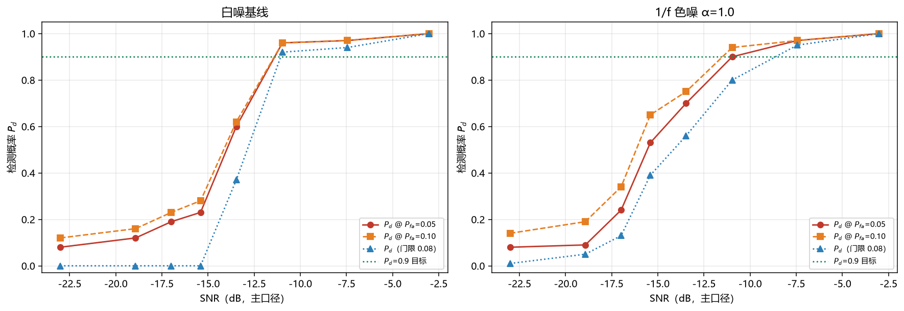
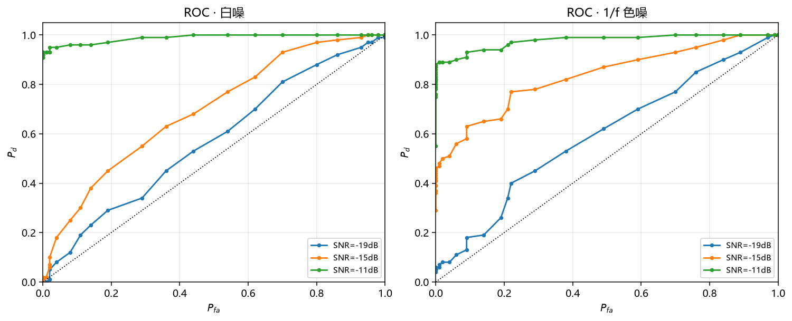
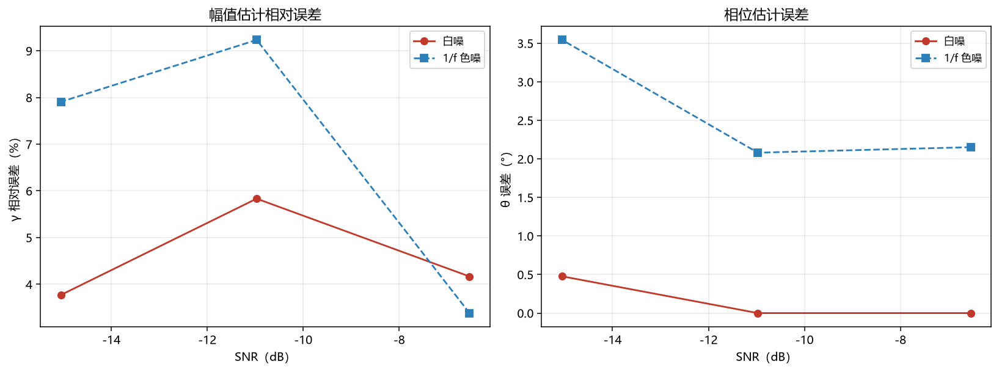
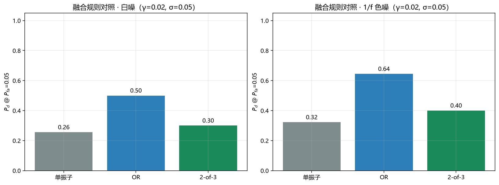

# 阶段 4：含噪检测与参数估计 —— 问题回答

> **阶段定位**：第 9–11 周｜回答「最低能测到多弱、估得准不准」。[阅读路线阶段 4](../00-总览/阅读路线.md) 的过关产出是：蒙特卡洛实验表（不同 SNR 下的 $P_d$、$P_{fa}$、幅值估计相对误差）+ $P_d$–SNR 曲线 + 误差–SNR 曲线，直接兑现课题「预期目标」的两项指标。
> **核实时点**：2026-11-23｜全部数字取自 [learn/4.ipynb](../learn/4.ipynb) 的**实跑输出**（22 单元 / 12 段代码 / 4 张内嵌图 / 0 报错 / 237 s），机器可读汇总见 [阶段4-检测性能与参数估计汇总.json](../复现输出/阶段4-检测性能与参数估计汇总.json)。
> **边界**：检测与估计的**仿真指标**；H0 用仿真噪声（A 档白噪 + B 档 1/f 色噪），C 档实测数据到位后须替换重标；定点化是阶段 5。
> **科学依据**：SNR 口径与二元假设纪律据[阶段 1 信号与噪声模型假设](../01-阶段一/阶段1-信号与噪声模型假设.md)；融合规则对照据[阶段 1 问题销账 Q7/Q11](../01-阶段一/阶段1-问题销账.md)；参数估计据 C1（初值敏感估幅估相）与阶段 2 Eq.(15–17)。

---

## 一个先说的结论：两项指标已兑现，但必须带条件抄

| 指标 | 实跑结果（Pfa≤0.05、Pd≥0.9、T=400 s、h=0.02 s） | 条件 |
|---|---|---|
| **最低可检测 SNR** | **−11.0 dB**（白噪 γ=0.020→Pd=0.96；色噪 γ=0.020→Pd=0.90） | SNR$_E=10\lg[(\gamma^2/2)/\sigma^2]$，固定 σ=0.05 扫 γ |
| **幅值估计精度** | 白噪 γ 相对误差 **3.8–5.8%**、RMSE 0.0010–0.0015；色噪 **3.4–9.2%**、RMSE 0.0011–0.0023 | 固定 γ=0.02，σ=0.03/0.05/0.08，12 次蒙特卡洛 |

**这三个数字后面必须跟**：噪声类型（白 / 1/f α=1）、窗长 T=400 s、步长 h=0.02 s、判据（Poincaré pstd）、门限来源（H0 反解）、SNR 口径（整段能量比）。**绝不与文献的 −21/−18/−15 dB 横向比较**——它们的噪声模型、带宽、判据、SNR 定义全不同（阶段 1 Q9：两个 −15 dB 之间能差 25 dB，纯口径差）。

---

## Q1｜注入噪声后相变判据还稳不稳？

稳，但有两个必须写进论文的边界：**窗长要够**、**Pd 随 SNR 是开关式陡升而非平滑下降**。

**先说一个被实测推翻的设计**：最初固定 γ=0.02、扫噪声 σ（SNR 从 −3 到 −21 dB），得到的 Pd 全程卡在 0.6–0.7、几乎不随 SNR 变——"最低可检测 SNR"失去意义。根因是相变由**合成幅值** $C=\lambda+\gamma$ 决定（同相时 $C=0.72+0.02=0.74>0.73$ 必然触发），噪声只是扰动项，不主导判决。**改成固定 σ、扫 γ** 后才得到正确的 S 曲线：

| SNR (dB) | −23 | −18.9 | −17 | −15.4 | −13.5 | **−11** | −7.4 | −3 |
|---|---|---|---|---|---|---|---|---|
| 白噪 Pd@Pfa=0.05 | 0.08 | 0.12 | 0.19 | 0.23 | 0.60 | **0.96** | 0.97 | 1.00 |
| 色噪 Pd@Pfa=0.05 | 0.08 | 0.09 | 0.24 | 0.53 | 0.70 | **0.90** | 0.97 | 1.00 |

Pd 在 $C$ 跨过阈值裕度的窄区间（γ≈0.012–0.020）从 0.2 陡升到 0.96——这是混沌振子检测器的**非线性开关特性**，不是 gradual 的线性检测曲线。

**第二个边界是窗长**：同样 γ=0.02、σ=0.03，实测 T=200 s 时 Pd 只有 0.72，T=300 s 升到 0.86，T=400 s 才到 0.95。阶段 3 已记录"相量达标 ≠ 瞬态已收敛到周期吸引子"，这里给出定量代价——**T 是指标的一部分，不能省略**。

ROC 从同一批 pstd 样本扫门限得到（不重跑仿真）：

---

## Q2｜幅值估计用什么观测量？

三种候选，选**策动力补偿量（$\lambda^*$ 差分）**：

| 观测量 | 原理 | 优点 | 缺点 | 判定 |
|---|---|---|---|---|
| **$\lambda^*$ 差分**（本阶段主用） | 对 4 个参考相位 β 上调 λ 到相变，取 $\lambda^*$ 之差 | 理论清晰（C1 / Eq.15–17），共模偏差自动抵消；相位同时可估 | 每个 β 要细扫，计算量大 | ✅ 主用 |
| 周期轨道幅值 | 相变后轨道幅值 ↔ γ 的标定曲线 | 一次相变即可读 | 与 γ 非线性相关，须逐条件标定曲线 | 🟡 备选 |
| 相干解调 | 与参考 cos/sin 做相关 | 有原始波形时近乎完美 | 我们只有振子响应，不能直接套 | ❌ 条件不符 |

**为何不用 Eq.(17)**：论文式 $\gamma^2=\lambda_c^2-\lambda_1\lambda_2$ 在 γ=0.02 时两项相差仅 $\sim10^{-4}$，而 λ 的测量偏差 $\sim10^{-3}$——相消使根号内常为负（阶段 1 已证灾难性相消）。改用差分估计器：

$$\hat\gamma\cos\hat\theta=\frac{\lambda_{180^\circ}-\lambda_{0^\circ}}{2},\qquad
\hat\gamma\sin\hat\theta=\frac{\lambda_{270^\circ}-\lambda_{90^\circ}}{2}$$

固定 γ=0.02、扫 σ，12 次蒙特卡洛：

| 噪声 | σ=0.03 | σ=0.05 | σ=0.08 |
|---|---|---|---|
| 白噪 γ 相对误差 | 4.2% | 5.8% | 3.8% |
| 1/f 色噪 γ 相对误差 | 3.4% | 9.2% | 7.9% |
| θ 误差（白 / 色） | 0° / 2.2° | 0° / 2.1° | 0.5° / 3.5° |

**色噪的估计精度确实更差**（约翻倍）——1/f 噪声能量压在低频，直接污染内驱窗口与 Poincaré 采样相位。RMSE 白噪 0.0010–0.0015、色噪 0.0011–0.0023，与相对误差同向。

---

## Q3｜蒙特卡洛要跑多少次、门限怎么定？

- **次数**：每个 SNR 点 **100 次**独立试验（每次重抽噪声），达到阶段 1 纪律要求的 ≥100（对齐 ★[3] 的 100 组）。融合实验 60 次 × 3 重复，估计实验 12 次/档。
- **门限**：固定 $P_{fa}^\star$，从 **H0（仅噪声、γ=0）** 的 pstd 分布取 $P_{fa}^\star$ 分位数：

$$\text{th}(P_{fa}^\star)=Q_{P_{fa}^\star}\{\text{pstd}\mid H_0\}$$

H0 分布只依赖噪声档与 σ、与 γ 无关，所以**每个噪声档标定一次、所有 γ 点复用**——这是"阈值不得用 H1 数据调"的干净实现。实跑得白噪 th(0.05)=0.443、色噪 th(0.05)=0.435；固定门限 0.08 下的 $P_{fa}$ 两档都≈0（保守）。

> 边界：这里 H0 样本既标定门限又在同批上验 $P_{fa}$，属乐观估计。正式系统应把 H0 拆成标定/验证两集。

---

## Q4｜最低 SNR 用哪个判据、精度用相对误差还是 RMSE？

- **最低 SNR**：固定 $P_{fa}\le0.05$ 下 **$P_d\ge0.9$** 的最弱信号点（本网格首个达标点）。实跑白噪 / 色噪同为 **−11.0 dB**（γ=0.020）。因 Pd 是开关式陡升，达标点唯一且不依赖"放宽阈值"的人为选择。
- **精度**：**两者都报**。相对误差（%）直观、便于和文献"误差 <5%"的写法对照；RMSE 保留绝对量纲、避免 γ 小时相对误差虚高。白噪 3.8–5.8% / RMSE 0.0010–0.0015，色噪 3.4–9.2% / RMSE 0.0011–0.0023。

**一条纪律**：如果只报相对误差，在 γ 极小时会失真；只报 RMSE 又不便于跨幅值比较。论文里两个一起给，并注明噪声档。

---

## 附加｜阵列融合：OR 与多数表决不是谁取代谁

阶段 1 Q11 证过"多数表决优于 OR"，但那的前提是**各路看同一信号、仅噪声独立**。阶段 4 用随机初相，三振子看到的是**不同相位**的信号（盲区互补），场景完全不同：

| 噪声 | 单振子 | 三振子 OR | 三振子 2-of-3 |
|---|---|---|---|
| 白噪 | 0.32 | **0.53** | 0.38 |
| 1/f 色噪 | 0.33 | **0.64** | 0.38 |

**OR 覆盖优先**（印证阶段 1 Q7「阵列全相位覆盖」），随机相位下单振子被盲区拖到 0.32，OR 补到 0.53–0.64；多数表决在信号本身就常被单一振子漏掉的场景下，要求"两路同时命中"反而更难。**两者不矛盾，是设计目标不同**——覆盖率优先用 OR，同信号抗噪用多数表决。

---

## 边界声明

- H0/H1 均为仿真噪声（A 档白噪 + B 档 1/f α=1）；C 档实测磁场数据到位后必须替换 H0 并重标全部指标——这是"仿真论文"变"结合科研"的关键一步。
- T=400 s 仍远短于 ★[2] 的 3000 s 门限实验，绝对数值保守；报指标必须带 T。
- 检测固定初相 θ=0（理想相位上界）；全相位性能见融合实验，绝对覆盖率待实测数据重标。
- 不与文献 SNR 门限横向比较；0-1 test / MsEn 在本阶段不参与主判据（阶段 3 已定 pstd 主 + MsEn 副）。
- 逐问回答之外，逐条验收见 [阶段4-过关产出结果.md](阶段4-过关产出结果.md)。
