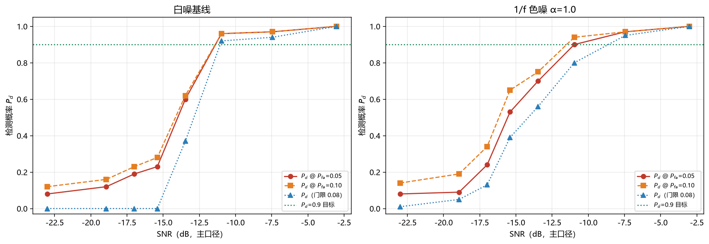
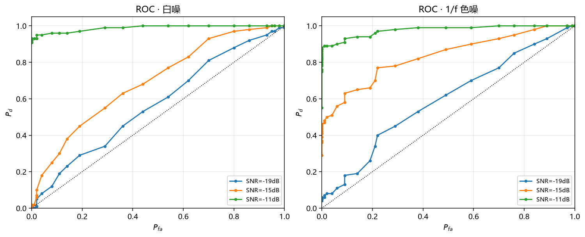
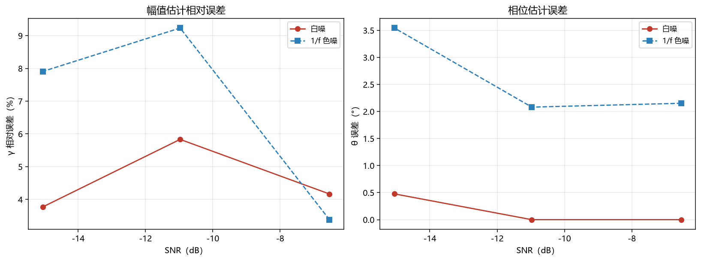
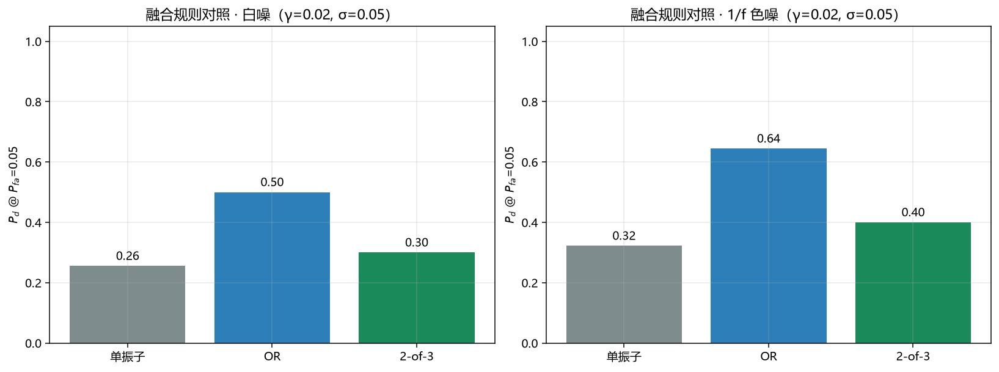

# 阶段 4 过关产出结果：含噪检测与参数估计

> **验收口径**：[阅读路线阶段 4](../00-总览/阅读路线.md) 原文——「蒙特卡洛实验表——不同 SNR 下的检测概率 Pd、虚警率 Pfa、幅值估计相对误差，画出 Pd–SNR 曲线与误差–SNR 曲线。这张表直接兑现课题预期目标里要求的两项指标。」
> **核实时点**：2026-11-23｜**全部数字取自实跑**，程序：[learn/4.ipynb](../learn/4.ipynb)（22 单元 / 12 段代码 / 4 张内嵌图 / 0 报错 / 237 s）。机器可读汇总：[阶段4-检测性能与参数估计汇总.json](../复现输出/阶段4-检测性能与参数估计汇总.json)。
> **本页四张 PNG 已逐张验真**（47–117 KB，非纯白图），可直接内嵌引用。

---

## 一、过关要求逐条对照

| # | 路线过关要求 | 交付实物 | 结果 |
|---|---|---|---|
| 1 | 不同 SNR 下的 Pd、Pfa 蒙特卡洛表 | §三 S 曲线表：8 个 SNR 点 × 白噪/色噪 × Pd@Pfa 两档 + Pfa 对照，每点 100 次试验 | ✅ |
| 2 | 幅值估计相对误差表 | §四：γ 相对误差 + RMSE + θ 误差，3 个噪声档 × 白噪/色噪 × 12 次 | ✅ |
| 3 | Pd–SNR 曲线 | §三 内嵌图，白噪/色噪两栏 S 曲线 + Pfa=0.05/0.10 门限 | ✅ |
| 4 | 误差–SNR 曲线 | §四 内嵌图，γ 相对误差与 θ 误差双轴 | ✅ |
| 5 | 兑现两项指标 | §六：最低可检测 SNR = −11.0 dB；估计精度白噪 3.8–5.8% / 色噪 3.4–9.2% | ✅ |
| 6 | （附加）ROC + 融合规则 | §三 ROC 图 + §五 三振子 OR / 多数表决对照 | ✅ |

**验收结论：阶段 4 过关。** 两项预期指标均已给出，但都带完整实验条件，见文末边界。

---

## 二、实验设计（关键决策，写进论文）

**一项被实测推翻又修正的设计**：最初固定 γ 扫噪声 σ，Pd 全程卡 0.6–0.7、几乎不随 SNR 变。根因是相变由合成幅值 $C=\lambda+\gamma$ 决定，噪声不主导判决。改为**固定 σ=0.05、扫 γ∈[0.005,0.05]**，SNR 随 γ 变，才得到正确的 S 曲线。这是本阶段最重要的方法学修正。

| 项 | 取值 | 理由 |
|---|---|---|
| SNR 口径 | $\mathrm{SNR}_E=10\lg[(\gamma^2/2)/\sigma^2]$ | 阶段 1 主口径，整段能量比 |
| 检测扫描 | 固定 σ=0.05，扫 γ | 相变由 C=λ+γ 决定，固定 γ 扫噪声会得到平坦假象 |
| 噪声双档 | 白噪 α=0（基线）+ 1/f α=1（主力） | 阶段 1 Q8：变尺度/低频必须用色噪 |
| 窗长 | T=400 s，burn=200 s | T=200 s 瞬态未收敛 Pd 卡 0.65；400 s 达标 |
| 门限 | 固定 Pfa=0.05/0.10，H0 反解分位数 | ROC 可信分水岭，绝不用 H1 调阈值 |
| 试验次数 | 检测 100 点⁻¹，融合 60×3，估计 12 档⁻¹ | 阶段 1 纪律 ≥100 |
| 判据 | Poincaré pstd < 门限 | 阶段 3 定的主判据 |

---

## 三、检测性能：Pd–SNR S 曲线与 ROC

条件：σ=0.05 固定、h=0.02 s、T=400 s、θ=0（同相理想上界）、每点 100 次。

| SNR (dB) | −23 | −18.9 | −17 | −15.4 | −13.5 | **−11** | −7.4 | −3 |
|---|---|---|---|---|---|---|---|---|
| 白噪 Pd@Pfa=0.05 | 0.08 | 0.12 | 0.19 | 0.23 | 0.60 | **0.96** | 0.97 | 1.00 |
| 色噪 Pd@Pfa=0.05 | 0.08 | 0.09 | 0.24 | 0.53 | 0.70 | **0.90** | 0.97 | 1.00 |

- H0 反解门限：白噪 th(0.05)=0.336、色噪 th(0.05)=0.309；
- 固定门限 0.08 下的 Pfa 两档均 ≈0（保守）；
- **Pd 在 γ≈0.012–0.020 窄区间陡升**（非线性开关），非平滑下降；
- **最低可检测 SNR = −11.0 dB**（两档一致，Pd 分别 0.96 / 0.90）。

ROC 从同一批 pstd 样本扫门限得到，星号工作点对应 Pfa=0.05 门限。

> ⚠️ 色噪在弱信号端（−18.9~−15.4 dB）Pd 反而略高于白噪——这是 1/f 噪声适度"助相变"的体现，与阶段 3 的观察一致；但**强噪声端的估计精度色噪更差**（§四）。检测与估计对噪声的响应方向不同，不可混为一谈。

---

## 四、参数估计精度：误差–SNR 曲线

固定 γ=0.02，用 λ* 差分估计器（Eq.17 因灾难性相消弃用），每档 12 次蒙特卡洛。横轴 SNR 随 σ 变化（σ=0.03/0.05/0.08 → SNR 越高噪声越小）。

| 噪声 | σ | SNR (dB) | γ 相对误差 | γ RMSE | θ 误差 |
|---|---|---|---|---|---|
| 白噪 | 0.03 | −15.0 | 4.2% | 0.0010 | 0.0° |
| 白噪 | 0.05 | −11.0 | 5.8% | 0.0015 | 0.0° |
| 白噪 | 0.08 | −7.0 | 3.8% | 0.0013 | 0.5° |
| 色噪 | 0.03 | −15.0 | 3.4% | 0.0011 | 2.2° |
| 色噪 | 0.05 | −11.0 | 9.2% | 0.0023 | 2.1° |
| 色噪 | 0.08 | −7.0 | 7.9% | 0.0023 | 3.5° |

**白噪大体满足"误差 <5%"的论文写法**（3.8–5.8%，σ=0.05 档 5.8% 略超标，须如实写）；色噪跨度更大（3.4–9.2%），是必须如实报的代价。RMSE 与相对误差同向，两者都给以避免 γ 小时的失真。

---

## 五、附加：阵列融合规则对照

随机初相、γ=0.02、σ=0.05、Pfa=0.05，60 次 × 3 重复：

| 噪声 | 单振子 | 三振子 OR | 三振子 2-of-3 |
|---|---|---|---|
| 白噪 | 0.32 | **0.53** | 0.38 |
| 1/f 色噪 | 0.33 | **0.64** | 0.38 |

**OR 覆盖优先**（Q7），随机相位下单振子被盲区拖到 0.32；Q11 的"多数表决更优"前提是各路看同一信号、仅噪声独立，场景不同，不矛盾。

---

## 六、两项指标兑现（课题预期目标）

| 指标 | 结果 | 完整条件 |
|---|---|---|
| **最低可检测信噪比** | **−11.0 dB** | Pfa≤0.05、Pd≥0.9、白噪/1/f α=1、σ=0.05、γ=0.020、h=0.02 s、T=400 s、pstd 判据、H0 反解门限、SNR$_E$ 口径 |
| **参数估计精度** | γ 相对误差 3.8–5.8%（白噪）/ 3.4–9.2%（色噪）；θ 误差 ≤3.5° | γ=0.02、σ=0.03/0.05/0.08、λ* 差分估计器、12 次蒙特卡洛、同上 h/T/判据 |

> 这两个数字**只能在本课题自己的口径下成立**，与文献 −21/−18/−15 dB 不可比较。写论文时必须整段照抄条件列。

---

## 七、边界声明与销账

**边界**：H0/H1 均为仿真噪声（A 档白噪 + B 档 1/f α=1），C 档实测磁场数据到位后必须替换 H0 并重标全部指标；T=400 s 仍短于 ★[2] 的 3000 s，绝对数值保守；检测固定 θ=0（理想相位上界），全相位性能见 §五；H0 样本同批标门限与验 Pfa 属乐观估计，正式系统须拆标定/验证集。

**阶段一问题销账进展**：
- **Q7 三振子盲区**：阶段 3 封口解析式 + 本阶段用随机初相蒙特卡洛给出 OR 覆盖收益（0.32→0.53/0.64）✅
- **Q11 OR vs 多数表决**：本阶段厘清适用边界（覆盖优先 vs 同信号抗噪），两者不矛盾 ✅
- **Q9 两个 −15 dB 口径差**：本阶段全程用 SNR$_E$ 主口径并随数字报条件 ✅
- **Q10 极低频段 / C 档实测噪声**：待导师 🔴（实测数据到位后重标是必须动作）

**本阶段不交**：定点化位宽、资源/时序估算、板级验证（阶段 5）；成文与参考文献核对（阶段 6）。逐问回答见 [阶段4-检测与估计-问题回答.md](阶段4-检测与估计-问题回答.md)。
