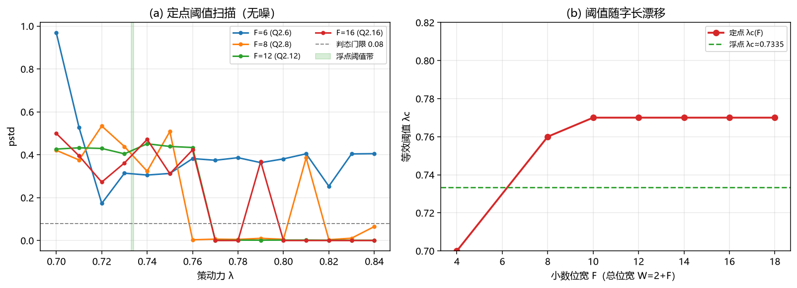
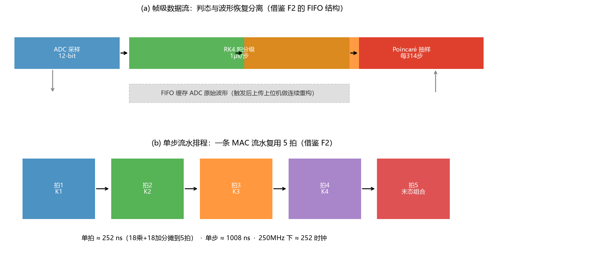

# 阶段 5 问题回答：嵌入式实现能不能落地

> 对应 [阅读路线阶段 5](../00-总览/阅读路线.md)「带着问题读」的四问；全部数字取自实跑，程序 [learn/5.ipynb](../learn/5.ipynb)（25 单元 / 18 段代码 / 4 图 / 0 报错 / 347 s），机器可读汇总 [阶段5-定点化与资源时序汇总.json](../复现输出/阶段5-定点化与资源时序汇总.json)。
>
> **诚实边界**：本课题无 FPGA 板、无综合报告。本阶段是**定点数值仿真 + 基于 F2 实测工艺的换算 + 时序仿真图**，不是板级实测。凡「时钟/资源/实时性」均标注推算依据。

---

## Q1：浮点 RK4 改成定点要留多少位宽才不丢相变？

**答：Q2.F 的 F=10–12 是甜点区（总位宽 12–14 bit）；F=4/6/8 三种失效模式必须认得。**

用定点 Duffing 仿真器（状态/导数全程 Q2.F 整型乘加，策动力与噪声一起量化），无噪扫 $\lambda\in[0.70,0.84]$，取首个 $p_{\rm std}<0.1$ 为等效阈值 $\lambda_c$，结果：

| 字长 | 等效阈值 λc | 失效模式 |
|---|---|---|
| F=4 (W=6) | 伪 λc≈0.70 | **动力学塌缩**：全程 pstd≈0，状态被量化锁死，处处"假周期" |
| F=6 (W=8) | 无 | **相变消失**：量化误差压过相变，整个网格都混沌（pstd 0.20–0.43） |
| F=8 (W=10) | ≈0.76 | **伪周期回弹**：λ=0.76 已相变，λ=0.80 又弹回混沌 |
| F=10/12/14/16/18 | ≈0.77 | 稳定，无回弹；F≥14 阈值不再改善，纯属浪费资源 |

**为什么 F=4 不是「最省资源」**：它的 pstd 全程≈0，看起来 everywhere 都"周期"，实际是定点锁死——用 pstd<门限 判据会得到 100% 虚警。F=6 则相反，永不判周期，100% 漏检。**位宽不足不是精度问题，是判据彻底失效**。

**为什么定点阈值比浮点高 3–5%**（0.735 → 0.77）：量化相当于给状态注入与幅度相关的扰动能，需要更大的策动力才能压进大尺度周期态。这与阶段 2 的步长敏感性、阶段 3 的噪声助相变是同一族现象——数值实现本身参与动力学。

---

## Q2：一次迭代几个时钟周期？

**答：基于 F2 实测工艺换算 ≈1008 ns/步 ≈ 252 时钟 @250 MHz；这是换算不是综合。**

数清经典 RK4 单步的算子数（状态 $v=(x,y)$，$y'=-0.5y+x^3-x^5+{\rm drive}$）：

- 每级导数：$x^2,x^3,x^5$ 三次乘 + $0.5y$ 一次乘 = **4 乘**；$-0.5y+x^3-x^5+{\rm drive}$ = **3 加**；
- 4 级 RK4：16 乘 + 12 加；末态组合（$h/6$ 预乘进 k）：2 乘 + 6 加；
- **单步合计 18 乘 + 18 加 = 36 op**。

换算锚点取自 F2（曹保锋等，电子学报 2019，Zynq-7045，250 MHz）实测「一次乘 24 ns、一次加 32 ns」，其 5 级 RTRK4 双振子实测 1440 ns/步。本课题单振子、4 级 RK4、算子更少：

$$18\times24 + 18\times32 = 1008\ {\rm ns/步} \approx 252\ {\rm 时钟\ @250\,MHz}$$

> ⚠️ F2 的 24/32 ns 是它那块板子的数，本课题未做综合。这两个数只用于**量级判断**；真要报时钟周期，必须在目标 FPGA 上跑综合时序报告。

---

## Q3：阵列多振子是并行例化还是时分复用？

**答：选 TDM 单核 + FIFO 帧缓存；因为计算根本不是瓶颈。**

| 方案 | DSP 乘数 | 帧计算（20000 步） | 相对资源 |
|---|---|---|---|
| 三振子并行例化 | 54 | 20.2 ms | 3× |
| **TDM 单核** | **18** | **60.5 ms** | **1×** |

一帧 20000 步（对应阶段 4 的 T=400 s、h=0.02），单振子 20.2 ms、三振子 TDM 60.5 ms——而物理观测窗是 **400 s**，计算加速比约 19841×（单振子）。两种方案都远快于物理过程，所以**资源优先**：TDM 单核省 2/3 DSP。

代价是需要帧缓存保证三路时间对齐（阶段 1 Q7 全相位覆盖要求同帧比较），并接受 3× 帧延迟——60.5 ms 对 400 s 窗完全可以忽略。

**与 F2 的异同**：F2 面临 10 MHz 采样率的硬实时约束（闪电脉冲 μs 级），必须数据分段并行 + FIFO 波形恢复；本课题信号周期以百秒计，采样率要求低 5 个数量级，所以**不需要分段并行**，只需沿用它的 FIFO 分离思想（见 Q4）。

---

## Q4：判态模块放在数据流哪一级？

**答：三级流水——RK4 积分级（每步）→ Poincaré 抽样式判态级（每 314 步）→ 帧级 pstd 判决（每帧）；波形恢复走 FIFO 旁路，与判态分离。**

1. **RK4 积分级**：每步算一次，1008 ns，输出状态 x；
2. **Poincaré 抽样**：每 $2\pi/h=314$ 步取一个点（与阶段 2/3 一致），这一步才进入判据通道；
3. **帧级 pstd 判决**：攒够一帧取后半段算 pstd，与门限比较输出 0/1——判据放在这里，因为 pstd 本质是帧统计量，放在每步级没有意义；
4. **FIFO 旁路**（借鉴 F2）：ADC 原始波形同时写入 FIFO，触发时才上传上位机做连续重构，判态模块**不碰原始波形**，避免分段/抽样造成波形畸变。

单步内部再分 5 拍复用一条 MAC 流水（K1→K2→K3→K4→末态组合），单拍 ≈252 ns，这是 F2「一条流水线跑 5 次」的复用思路在本课题的对应。

---

## 五个必须写进论文的边界

1. **无板级实测**：本阶段是定点数值仿真 + 工艺换算，没有综合报告、没有板卡；F2 的 24/32 ns 与 1440 ns 只作换算锚点。
2. **定点阈值要重标定**：换 FPGA / 换字长 / 换采样率都要重扫 $\lambda_c$，不能沿用浮点值——这是本阶段最实用的一条工程结论。
3. **观测窗不可压缩**：帧计算 20–60 ms，但物理观测 400 s；FPGA 再快只压掉"算一帧"的时间，压不掉信号本身的时标。
4. **初相盲区仍在**：定点化不解决阶段 3 的 $\Delta_{\max}\approx60.69°$ 盲区，阵列全相位覆盖照旧需要。
5. **不与文献 SNR 横向比较**：F2 的 −18 dB（闪电脉冲、双振子、波形相似度判据、Zynq-7045）与本课题的 −11 dB（正弦、单振子、pstd 判据、定点仿真）条件全不同，并列比较无意义。
