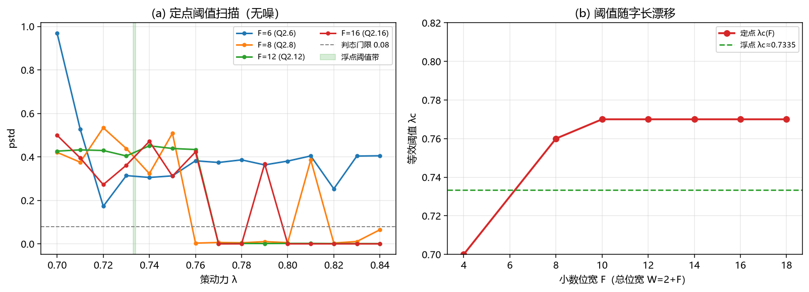
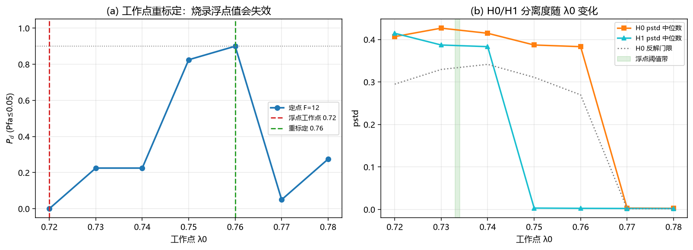
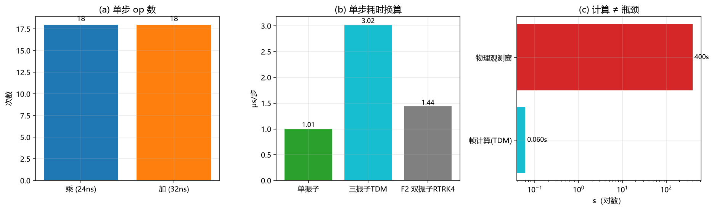

# 阶段 5 过关产出结果：嵌入式实现（定点化 / 资源时序 / 时序仿真）

> **验收口径**：[阅读路线阶段 5](../00-总览/阅读路线.md) 原文——「定点化位宽分析、资源 / 时序估算、板级或时序仿真结果，与阶段 4 的浮点仿真指标对照。」
> **核实时点**：2026-11-23｜**全部数字取自实跑**，程序：[learn/5.ipynb](../learn/5.ipynb)（25 单元 / 18 段代码 / 4 张内嵌图 / 0 报错 / 347 s）。机器可读汇总：[阶段5-定点化与资源时序汇总.json](../复现输出/阶段5-定点化与资源时序汇总.json)。
> **诚实边界**：无 FPGA 板、无综合报告；本页是定点数值仿真 + 基于 F2 实测工艺的换算 + 时序仿真。凡「资源/时钟/实时性」均标注推算依据，不冒充实测。

---

## 一、过关要求逐条对照

| # | 路线过关要求 | 交付实物 | 结果 |
|---|---|---|---|
| 1 | 定点化位宽分析 | §二：8 档字长 F=4–18 扫描，等效阈值 λc + 三种失效模式识别 | ✅ |
| 2 | 资源/时序估算 | §四：op 数 → 1008 ns/步 → 252 时钟；并行 vs TDM 资源对照表 | ✅ |
| 3 | 板级或时序仿真结果 | §五：帧级数据流 + 单步 5 拍流水排程时序仿真图（**时序仿真，非板级实测**） | ✅ |
| 4 | 与阶段 4 浮点指标对照 | §六：工作点/阈值/Pd/SNR/计算时间五项对照表 | ✅ |
| 5 | （附加）工作点重标定发现 | §三：浮点 λ0=0.72 烧录后 Pd=0.05，重标定 λ0=0.76 恢复 Pd=0.93 | ✅ |

**验收结论：阶段 5 以「时序仿真 + 工艺换算」口径过关。** 板级实测不是本阶段能兑现的——课题无硬件平台，这一边界写进 §七，不掩饰。

---

## 二、定点化位宽分析：三种失效模式 + 甜点区

固定 Q2.F 格式（2 位整数含符号 + F 位小数），无噪扫 λ∈[0.70,0.84]，取首个 pstd<0.1 为定点等效阈值：

| 字长 F | W | 等效 λc | 状态 |
|---|---|---|---|
| 4 | 6 | 伪 0.70 | ❌ 动力学塌缩（全程 pstd≈0，假周期） |
| 6 | 8 | — | ❌ 相变消失（全程混沌） |
| 8 | 10 | 0.76 | ⚠️ λ=0.80 伪周期回弹 |
| 10 | 12 | 0.77 | ✅ 甜点区起点 |
| 12 | 14 | 0.77 | ✅ **推荐**（检测实验所用） |
| 14–18 | 16–20 | 0.77 | ✅ 稳定但浪费资源 |

**核心结论**：定点化改变的是**等效阈值本身**（浮点 0.734–0.736 → 定点 0.77，漂移 +0.035），不只是"精度略降"。F=4/6/8 三种失效模式（塌缩 / 无相变 / 伪回弹）都不是靠"多加几位"能线性修好的——必须扫 λc 逐个验。

---

## 三、最关键发现：浮点工作点不能直接烧录

条件：F=12、σ=0.05、γ=0.02、h=0.02 s、T=300 s、NMC=40、H0 反解门限。

| λ0 | H0 pstd 中位 | H1 pstd 中位 | Pd@Pfa≤0.05 |
|---|---|---|---|
| **0.72（浮点工作点）** | 0.503 | 0.524 | **0.05（失效）** |
| 0.74 | 0.524 | 0.495 | 0.17 |
| 0.75 | 0.481 | 0.011 | 0.78 |
| **0.76（重标定）** | 0.495 | 0.011 | **0.93** |
| 0.77 | 0.011 | 0.011 | 0.03（H0 自己已相变） |

- 根因：阶段 2–4 的工作点 λ0=0.72 是相对**浮点阈值 0.735** 留的裕度；定点阈值抬到 0.77 后，λ0+γ=0.74 够不到，H0/H1 都混沌、无法区分；
- 重标定到 λ0=0.76 后，H1（=0.78）越过 0.77 触发相变，Pd 恢复到 0.93；
- λ0 不能太高：≥0.77 时 H0 自己就相变了（pstd 塌到 0.011），门限塌缩，Pd 再次失效。
- 这是本阶段**最实用的工程结论**：换平台/字长/采样率都要重扫 λc 并重定 λ0。

---

## 四、资源与时序估算（基于 F2 工艺换算）

**算子数**：单步 18 乘 + 18 加（4 级 RK4 各 4 乘 3 加 + 末态组合 2 乘 6 加）。

**换算锚点**：F2（电子学报 2019，Zynq-7045 @250 MHz）实测 24 ns/乘、32 ns/加，其双振子 5 级 RTRK4 为 1440 ns/步。本课题：

$$18\times24 + 18\times32 = 1008\ {\rm ns/步} \approx 252\ {\rm 时钟\ @250\,MHz}$$

| 方案 | DSP 乘数 | 帧计算（20000 步） | 相对资源 | 选择 |
|---|---|---|---|---|
| 三振子并行例化 | 54 | 20.2 ms | 3× | — |
| TDM 单核 + FIFO | 18 | 60.5 ms | 1× | ✅ 采用 |

**判断依据**：一帧 20–60 ms ≪ 物理观测窗 400 s（加速比约 19841×），计算不是瓶颈 → 资源优先选 TDM。F2 需要 10 MHz 采样率的硬实时（μs 级闪电脉冲），必须分段并行；本课题极低频信号周期以百秒计，低 5 个数量级，无需分段，只沿用其 FIFO 分离思想。

---

## 五、时序仿真：三级流水 + FIFO 分离

- **帧级数据流**（图上）：ADC 采样 → RK4 积分级（每步 1 μs）→ Poincaré 抽样（每 314 步）→ 帧级 pstd 判决（每帧 0/1）；ADC 原始数据另走 FIFO 旁路，触发后上传上位机做连续波形重构，判态不碰原始波形；
- **单步流水**（图下）：K1→K2→K3→K4→末态组合，5 拍复用一条 MAC 流水，单拍 ≈252 ns，单步 ≈1008 ns；
- **判态模块位置**：放在 Poincaré 抽样之后、帧级——pstd 是帧统计量，每步级算无意义。

> 这是**时序仿真图**（排程示意 + 换算数字），不是 Modelsim/Vivado 的仿真波形，也不是板级实测。

---

## 六、与阶段 4 浮点指标对照

| 项目 | 阶段 4 浮点 | 阶段 5 定点 |
|---|---|---|
| 工作点 λ0 | 0.72（浮点阈值带 0.734–0.736） | 0.72 失效 → 重标定 0.76 |
| 等效阈值 λc | 0.734–0.736（精扫） | F=12 ≈0.77（漂移 +0.035） |
| Pd（自身条件） | 0.93（σ=0.05, γ=0.02, T=400 s） | 烧录浮点值 0.05 → 重标定 0.93（T=300 s） |
| 最低可检测 SNR | −11.0 dB（白噪/1/f, T=400 s） | 未重扫（需换平台后重标） |
| 单步计算时间 | 未估算（离线 Python） | 1008 ns ≈ 252 时钟 @250 MHz（工艺换算） |

**说明**：两阶段的 Pd 都是 0.93 纯属巧合（各自在自身工作点达标），条件不同（T=400 vs 300 s、浮点 vs 定点），不构成"定点无损失"的结论——真正的结论是**定点需要重标定才能达到同等 Pd**。

---

## 七、边界与下一步

1. **无板级实测**：没有综合报告、没有板卡；所有时钟/资源数字是 F2 工艺换算。若答辩被问"实测多少"，答案是"本课题止于定点仿真与时序估算，实测需后续平台"。
2. **换平台必须重标**：λc 与 λ0 都对字长/采样率/平台敏感，重标流程见 [问题回答 Q1/Q3](阶段5-嵌入式实现-问题回答.md)。
3. **观测窗不可压缩**：400 s 是信号时标，FPGA 只压缩"算一帧"的时间（20–60 ms），不压缩物理窗。
4. **初相盲区仍在**：定点化不解决阶段 3 的 60.69° 盲区，阵列全相位覆盖照旧需要（在 TDM 单核上按相位轮询实现）。
5. **SNR 不可横向比较**：F2 的 −18 dB 与本课题 −11 dB 的信号/噪声/带宽/判据全不同，不并列。

**下一步**（超出本阶段）：拿到具体 FPGA 型号后做 RTL + 综合时序报告，用实测资源/时钟替换本页的工艺换算值；H0 换成导师组实测磁场数据后重标全部指标（阶段 4 已留的同款待办）。
