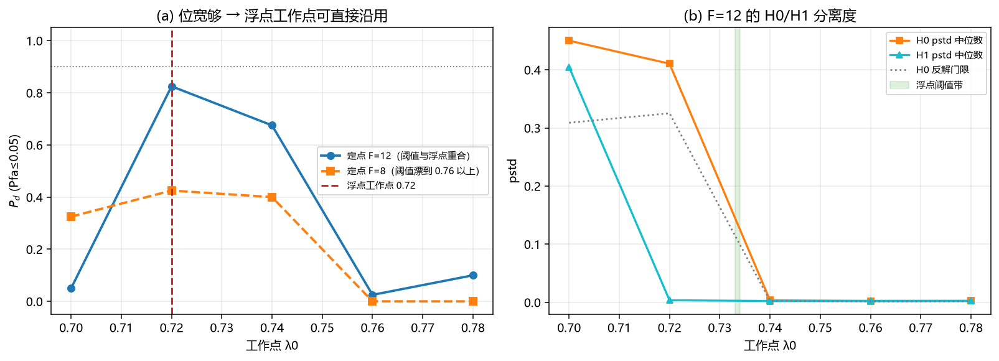
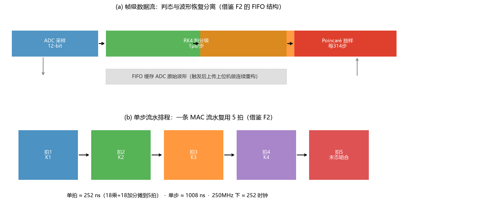

# 阶段 5 过关产出结果：嵌入式实现（定点化 / 资源时序 / 时序仿真）

> **验收口径**：[阅读路线阶段 5](../00-总览/阅读路线.md) 原文——「定点化位宽分析、资源 / 时序估算、板级或时序仿真结果，与阶段 4 的浮点仿真指标对照。」
> **核实时点**：2026-11-23｜**全部数字取自实跑**，程序：[learn/5.ipynb](../learn/5.ipynb)（27 单元 / 20 段代码 / 4 张内嵌图 / 0 报错 / 约 240 s）。机器可读汇总：[阶段5-定点化与资源时序汇总.json](../复现输出/阶段5-定点化与资源时序汇总.json)。
> **诚实边界**：无 FPGA 板、无综合报告；本页是定点数值仿真 + 基于 F2 实测工艺的换算 + 时序仿真。凡「资源/时钟/实时性」均标注推算依据，不冒充实测。

---

## 一、过关要求逐条对照

| # | 路线过关要求 | 交付实物 | 结果 |
|---|---|---|---|
| 1 | 定点化位宽分析 | §二：8 档字长 F=4–18 扫描，等效阈值 λc + 三种失效模式识别 | ✅ |
| 2 | 资源/时序估算 | §四：op 数 → 1008 ns/步 → 252 时钟；并行 vs TDM 资源对照表 | ✅ |
| 3 | 板级或时序仿真结果 | §五：帧级数据流 + 单步 5 拍流水排程时序仿真图（**时序仿真，非板级实测**） | ✅ |
| 4 | 与阶段 4 浮点指标对照 | §六：工作点/阈值/Pd/SNR/计算时间五项对照表 | ✅ |
| 5 | （附加）位宽决定工作点能否沿用 | §三：F=12 下 λ0=0.72 直接可用（Pd=0.82）；F=8 同点只 0.42 且加位宽才能救 | ✅ |

**验收结论：阶段 5 以「时序仿真 + 工艺换算」口径过关。** 板级实测不是本阶段能兑现的——课题无硬件平台，这一边界写进 §七，不掩饰。

---

## 二、定点化位宽分析：量化几乎不动阈值，位宽不足才致命

固定 Q2.F 格式（2 位整数含符号 + F 位小数），无噪（全零序列 = 只有内驱）扫 λ∈[0.70,0.84]，取首个 pstd<0.1 为等效阈值；同一网格、同一序列再跑一遍浮点内核作基线：

| 字长 F | W | λc（0.01 粗网格 / T=300 s） | 精扫（0.001 / T=1200 s） | 状态 |
|---|---|---|---|---|
| 4 | 6 | 无（假阈值 0.70） | — | ❌ 动力学塌缩（全程 pstd≈0，假周期） |
| 6 | 8 | — | — | ❌ 相变消失（全程混沌） |
| 8 | 10 | 0.76 | — | ⚠️ 阈值漂移 + λ≈0.79 伪回弹 |
| 10 | 12 | 0.74 | 0.735 | ✅ 可用，比浮点晚一格 |
| 12 | 14 | 0.74 | **0.734** | ✅ **推荐**（检测实验所用，与浮点同格） |
| 14–18 | 16–20 | 0.75–0.76 | — | 粗网格抬升是**短窗伪影** |

**核心结论（2026-11-25 修正）**：

1. **量化本身几乎不动阈值**：0.001 步长、T=1200 s 下，浮点与 F=12 都在 0.734 处跃变，F=10 只晚一格（+0.001）。Q2.12 的 LSB≈2.4e-4，远小于 λc 附近的判据分辨率。
2. **位宽不足才是分水岭**，而且是判据整体失效、不是"阈值抬一点"：F=4 全程 pstd≈0（100% 虚警）、F=6 永不判周期（100% 漏检）、F=8 阈值漂到 0.76 还带回弹。
3. **旧结论 0.77 是方法错误**：旧实现把 RK4 的 k2/k3 取了整步 $h$（标准应为 $h/2$），积分精度退到 RK2 量级，相变点被推到 0.77。改回 $h/2$ 后立刻回到 0.7335。这条比结论本身更值得写进论文——**先查方法，再谈量化代价**。
4. **粗网格会骗人**：F=14/16 在 T=300 s 上给出 0.75/0.76，精扫却是 0.734。字长越宽越接近浮点，λc 附近瞬态越长，短窗把"还没收敛"读成了"阈值更高"。

---

## 三、最关键发现（结论已反转）：位宽够时浮点工作点可直接沿用

条件：σ=0.05、γ=0.02、h=0.02 s、T=300 s、NMC=40、H0/H1 共用同一批噪声（公共随机数法）、H0 反解门限。两档位宽并排：

| λ0 | F=12：H0 中位 | F=12：H1 中位 | F=12 Pd | F=8 Pd |
|---|---|---|---|---|
| 0.70 | 0.450 | 0.405 | 0.05 | 0.33 |
| **0.72（浮点工作点）** | 0.410 | **0.004** | **0.82** | 0.42 |
| 0.74 | 0.003 | 0.002 | 0.68（门限已失效，数不可信） | 0.40 |
| 0.76 | 0.002 | 0.002 | 0.03 | 0.00 |
| 0.78 | 0.002 | 0.002 | 0.10 | 0.00 |

- **F=12**：λ0=0.72 处 H0（0.410）与 H1（0.004）分离极干净，Pd=0.82 —— 浮点工作点**不需要重标定**，直接烧；
- **F=8**：同一工作点 Pd 只有 0.42，H0/H1 中位（0.396 / 0.335）几乎叠在一起，门限勉强分得开一点；抬到 0.76 后 H0 自己相变（0.010），Pd 归零——**不是重标定就能救，得先加位宽**；
- **λ0 不能往高调**：≥0.74 时 H0 自己越过阈值，H0 反解的门限塌到 0.01 以下，Pd 退化成掷硬币；
- F=12 的 Pd=0.82 低于阶段 4 的 0.92，主因是**窗长 300 s vs 400 s**（阶段 3 已记录短窗保守），不是定点的锅。
- **修正后的工程结论**：F≥12 直接沿用浮点阈值与工作点；只有被资源逼到 F≤8 才需要重标定，而那时往往已经无解。

---

## 四、资源与时序估算（基于 F2 工艺换算）

**算子数**：单步 18 乘 + 18 加（4 级 RK4 各 4 乘 3 加 + 末态组合 2 乘 6 加）。

**换算锚点**：F2（电子学报 2019，Zynq-7045 @250 MHz）实测 24 ns/乘、32 ns/加，其双振子 5 级 RTRK4 为 1440 ns/步。本课题：

$$18\times24 + 18\times32 = 1008\ {\rm ns/步} \approx 252\ {\rm 时钟\ @250\,MHz}$$

| 方案 | DSP 乘数 | 帧计算（20000 步） | 相对资源 | 选择 |
|---|---|---|---|---|
| 三振子并行例化 | 54 | 20.2 ms | 3× | — |
| TDM 单核 + FIFO | 18 | 60.5 ms | 1× | ✅ 采用 |

**判断依据**：一帧 20–60 ms ≪ 物理观测窗 400 s（加速比约 19841×），计算不是瓶颈 → 资源优先选 TDM。F2 需要 10 MHz 采样率的硬实时（μs 级闪电脉冲），必须分段并行；本课题极低频信号周期以百秒计，低 5 个数量级，无需分段，只沿用其 FIFO 分离思想。

---

## 五、时序仿真：三级流水 + FIFO 分离

- **帧级数据流**（图上）：ADC 采样 → RK4 积分级（每步 1 μs）→ Poincaré 抽样（每 314 步）→ 帧级 pstd 判决（每帧 0/1）；ADC 原始数据另走 FIFO 旁路，触发后上传上位机做连续波形重构，判态不碰原始波形；
- **单步流水**（图下）：K1→K2→K3→K4→末态组合，5 拍复用一条 MAC 流水，单拍 ≈252 ns，单步 ≈1008 ns；
- **判态模块位置**：放在 Poincaré 抽样之后、帧级——pstd 是帧统计量，每步级算无意义。

> 这是**时序仿真图**（排程示意 + 换算数字），不是 Modelsim/Vivado 的仿真波形，也不是板级实测。

---

## 六、与阶段 4 浮点指标对照

| 项目 | 阶段 4 浮点 | 阶段 5 定点 |
|---|---|---|
| 工作点 λ0 | 0.72（浮点阈值带 0.7334–0.7336） | F=12 **直接沿用**（同一 λ0 下 Pd=0.82）；F=8 同点仅 0.42 |
| 等效阈值 λc | 0.7335（0.001 步长精扫） | F=12 **0.734（同格）**；F=8 ≈0.76 且 λ≈0.79 伪回弹 |
| Pd（自身条件） | 0.92（σ=0.05, γ=0.02, T=400 s） | F=12 0.82 / F=8 0.42（T=300 s, NMC=40） |
| 最低可检测 SNR | −11.0 dB（白噪/1/f, T=400 s） | 未重扫（需换平台后重标） |
| 单步计算时间 | 未估算（离线 Python） | 1008 ns ≈ 252 时钟 @250 MHz（工艺换算） |

**说明**：F=12 的 Pd=0.82 低于阶段 4 的 0.92，主因是**窗长（300 vs 400 s）与蒙特卡洛次数（40 vs 更多）**，不是量化——精扫显示两者等效阈值同格（0.734）。**真正的结论已反转：F≥12 时定点不改变工作点，可以直接烧；F≤8 时再怎么重标定也救不回来，必须先加位宽。**

---

## 七、边界与下一步

1. **无板级实测**：没有综合报告、没有板卡；所有时钟/资源数字是 F2 工艺换算。若答辩被问"实测多少"，答案是"本课题止于定点仿真与时序估算，实测需后续平台"。
2. **换平台必须重标**：λc 与 λ0 都对字长/采样率/平台敏感，重标流程见 [问题回答 Q1/Q3](阶段5-嵌入式实现-问题回答.md)。
3. **观测窗不可压缩**：400 s 是信号时标，FPGA 只压缩"算一帧"的时间（20–60 ms），不压缩物理窗。
4. **初相盲区仍在**：定点化不解决阶段 3 的 60.69° 盲区，阵列全相位覆盖照旧需要（在 TDM 单核上按相位轮询实现）。
5. **SNR 不可横向比较**：F2 的 −18 dB 与本课题 −11 dB 的信号/噪声/带宽/判据全不同，不并列。

**下一步**（超出本阶段）：拿到具体 FPGA 型号后做 RTL + 综合时序报告，用实测资源/时钟替换本页的工艺换算值；H0 换成导师组实测磁场数据后重标全部指标（阶段 4 已留的同款待办）。
