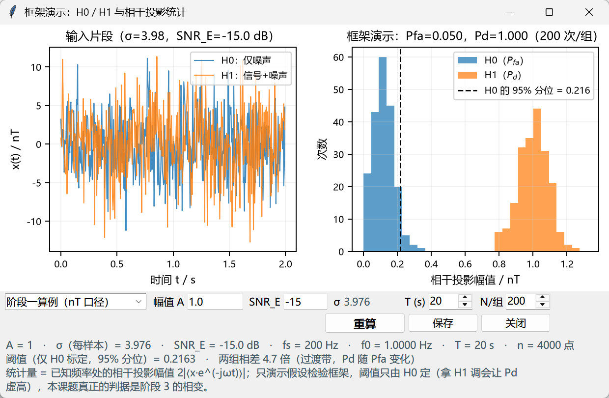

# 端到端双端 UI：发送端与接收端

前面几份文档都是"离线跑一遍出图"，**这一份是实时联调**：一个窗口发、另一个窗口收，点按钮就能看到判决。

- 发送端 `tools/tx_app.py`：模拟目标发出的极低频磁场，**启动后一直发、不自动停**；发送过程中可随时「附加目标信号」，目标出现多久由参数决定。
- 接收端 `tools/rx_app.py`：持续监听、收帧、**一帧一判**（R 已知，不扫频），显示波形 / 频谱 / 阵列 $p_{std}$ / 相图 / 判决时序。
- 两者共用 `tools/link_proto.py`（协议 + 算法），线上样本为 **int16**（对齐 ESP32 ADC 计数），数值内核仍是 `kernel_src.simulate_seq`，**没有第二套积分器**。
- 判决工作点 $\lambda_0=0.73$（内核默认 0.72，界面按联调要求抬到 0.73，理由见第三节）。


---

## 一、启动方式

两个脚本各自独立运行，任一方先开后开都不影响（接收端先开更方便：可以看日志里"等发送端"的状态）。

```bat
:: 窗口 1：接收端（默认监听 0.0.0.0:50500，R 用已知值 10.0）
.venv\Scripts\python.exe tools\rx_app.py

:: 窗口 2：发送端（默认打向 127.0.0.1:50500）
.venv\Scripts\python.exe tools\tx_app.py
```

跨机联调时两头都要指定地址：

```bat
:: 接收端（在 192.168.1.20 上监听所有网卡）
.venv\Scripts\python.exe tools\rx_app.py --host 0.0.0.0 --port 50500

:: 发送端（从另一台机器发过去）
.venv\Scripts\python.exe tools\tx_app.py --host 192.168.1.20 --port 50500
```

发送端界面上还有个「打开接收端」按钮，会以子进程方式拉起 `rx_app.py` 并带上同一个端口号，省得手敲命令。

命令行参数一览（都很短，其余全在界面上）：

| 脚本 | 参数 | 默认 | 说明 |
|---|---|---|---|
| `tx_app.py` | `--host` | `127.0.0.1` | 目标地址 |
| | `--port` | `50500` | 目标端口 |
| `rx_app.py` | `--host` | `0.0.0.0` | 监听地址（填 0.0.0.0 收所有网卡） |
| | `--port` | `50500` | 监听端口 |
| | `--mode` | `known` | `known` 已知 R / `hint` 跟随发送端 / `auto` 盲测扫 R |

---

## 二、发送端参数

| 参数 | 默认 | 作用与约束 |
|---|---|---|
| 载波角频率 ω | 10.0 rad/s | 即 $f_0=1.5915$ Hz。接收端的 R 必须与它一致（或由它扫出来） |
| 信噪比 SNR | −7.4 dB | 滑块 −30…+5 dB。**幅值由它反算**：$A=\sigma\sqrt{2\cdot10^{\text{SNR}/10}}$ |
| 基线噪声 σ | 0.05 | 归一化策动力单位。噪声每样本标准差 $=\sigma\sqrt{\omega/f_s}$（力口径） |
| 采样率 $f_s$ | 500 Hz | 与接收端共享；收端默认"跟随发送端 fs" |
| 帧长 | 94.2 s | 一帧的物理时长＝47100 点 ≈ 150 个载波周期。**低于 48 周期判据会抖**（见第七节） |
| 噪声类型 | 白噪 | 另可选 $1/f$ 色噪（去 DC 的一阶积分噪声） |
| 发送信号（常开） | 开 | 勾上 = 每一帧都有目标，不自动停。取消勾选后只有「附加」窗口内才有目标 |
| 发送噪声 | 开 | 独立开关。关掉则是干净信号（$p_{std}$ 会低到 $10^{-3}$，无悬念） |
| 附加时长 | 180 s | 「附加目标」按钮开窗多久（秒）。按 $f_0$ 折算显示成"≈N 帧" |
| 随机种子 | 0 | 0 = 每次随机初相；填定值可复现同一帧 |
| 发送节奏 | 实时 ×10 | 实时 = 按 $\Delta t$ 限速（×10 即 10 倍速，UART 回放口径）；尽快 = 包间 2 ms |
| 目标地址 / 端口 | 127.0.0.1 : 50500 | 与接收端一致 |

**连续发送 + 手动附加目标**是这一版的核心改动。原来是"填帧数、发完就停"，现在启动后一直发，目标什么时候出现由你按按钮决定：

- 勾着「发送信号（常开）」→ 每帧都带目标（标定、演示用）。
- 取消勾选 → 常态是纯背景噪声；**发送中点「附加目标」**，从**下一帧起点**开始叠 $A\cos(\omega(t-t_{on})+\theta_0)$，持续「附加时长」秒后自动关断，界面状态行显示"目标窗至 t=xxx s"。
- 「撤销目标」= 立刻把窗口截到当前时刻，已发出的样本不受影响（改不了历史）。
- 相位跨帧连续：窗口模式下 $\varphi=\omega(t_{start}-t_{on})+\theta_0$，同一个目标不会因为跨帧而跳相——真实目标不会在帧边界换相位。
- 窗口不对齐帧，所以**末尾那一帧天然是"部分覆盖"**（$0<\text{cov}<1$），统计上单列，不算进 Pd 也不算进 Pfa。

**为什么 SNR 与幅值是绑定的**：接收端判的是"驱动幅值有没有把振子推过阈值"，物理量是幅值 $A$；而工程上人们更习惯说信噪比。所以界面上让你调 SNR，程序内部换成 $A$ 再发给接收端——头包里两个都带，方便对表。

**信号与噪声两个开关要分开**，是因为它们回答不同的问题：

- 只开信号（无噪声）→ 检查判据的**物理正确性**（$p_{std}$ 该到 $10^{-3}$）；
- 只开噪声（无信号）→ 测**虚警率**（$p_{std}$ 该停在 0.4 以上，判「无」）；
- 都开 → 真实工况。

---

## 三、接收端参数

| 参数 | 默认 | 作用与约束 |
|---|---|---|
| 监听地址 / 端口 | 0.0.0.0 : 50500 | 与发送端一致 |
| 采样间隔 $\Delta t$ | 0.002 s | 勾「跟随发送端的 fs」时自动取头包里的 $1/f_s$（**推荐**） |
| R 模式 | **已知 R** | 三选一，见下 |
| 已知 R | 10.0 rad/s | 已知模式用。必须与发送端 ω 一致，**偏 5% 就判不出来** |
| 工作点 $\lambda_0$ | 0.73 | 联调要求抬到 0.73（内核默认 0.72，比 $\lambda_c\approx0.7335$ 只低 0.0035）。实测分离度不变：目标帧 $1.4\text{e-}3\sim2.1\text{e-}3$，背景帧最小 $0.23$ |
| 判态门限 | 0.08 | $p_{std}$ 低于它算"该路共振"。混沌态约 0.4，周期态约 $10^{-3}$，中间没有含糊地带 |
| 阵列 | 三相位 ±120° | 三路或单路。三相位是为了补相位盲区（见第七节） |
| 估计幅值/相位 | 勾 | $\lambda^*$ 差分估计 $\hat\gamma$、$\hat\theta$，每帧多约 2.5 s |
| 每帧自动重算 | 勾 | 收到就自动算；取消则只记录不计算 |

### 三种 R 模式

用户明确说「可以已知 R，不用扫描 R」，所以默认走**已知 R**，扫 R 保留为论文的盲测流程：

| 模式 | 用时（47100 点） | 适用场景 |
|---|---|---|
| **已知 R**（默认） | **约 0.15 s**（含估幅约 2.8 s） | 联调、演示、已知目标频率的场合 |
| 跟随发送端 | 同上 | 联调最省事：不用两头各填一次，直接用头包里的 ω |
| 自动扫 R | 约 0.9 s | 论文流程：只拿序列与 $\Delta t$，FFT 粗估后在 ±1% 内两级细扫 |

已知 R 时仍然**不是"作弊"**：检测判决完全由 $p_{std}$ 与门限决定，R 只决定"在哪个时间尺度上看这个振子"。R 偏 5% 时驱动频率失谐到 1.05，共振塌掉、$p_{std}$ 从 $2.3\times10^{-3}$ 回到 $0.43$——这说明判决对 R 是敏感的，而**检测这件事本身仍然是靠动力学，不是靠对表**。

---

## 四、数据交互

### 4.0 一帧里装的是什么：信号 + 噪声，**没有策动力**

这条口径必须说清楚，否则看相图和频谱都会误读。整条链路里只有两种物理量：

```
发射序列  tx(t) = A·cos(ω t + φ)·gate(t)                     ← 目标磁场（归一化单位）
接收序列  rx(t) = tx(t)·10^(−α/20) + σ√h₁·n(t),  n~N(0,1)     ← 仅此两项，h₁=ω/fs
```

**策动力 $\lambda_0\cos t$ 不在任何一条线上**：它不发射、不传输、也不加进 `rx`。它是**接收端自己的振子内部驱动力**，只在判决那一刻出现在积分方程里：

$$\ddot x+\delta\dot x-x+x^3=\lambda_0\cos\tau+\underbrace{s(\tau)}_{\text{来自 }rx}$$

对应代码里，$\lambda_0$ 只作为 `pstd_array(..., lam=lam)` / `analyze(..., lam=lam)` 的参数传给内核（`simulate_seq` 里的 `f = lam*cos(tau+beta) + s`），而 `make_frame` 里的 `tx/rx` 完全不含它。换句话说：

- 发送端**不知道** $\lambda_0$ 是多少，也不需要知道——它只发磁场。
- 接收端把 `rx` 当成"外加激励 $s(\tau)$"塞进振子右边，振子自己再叠 $\lambda_0\cos\tau$。信号的作用是把**合成幅值**从 $\lambda_0$ 抬到 $\sqrt{\lambda_0^2+A^2+2\lambda_0A\cos\theta}$，越过 $\lambda_c$ 就翻到周期态。
- 所以"有信号"判据是**振子轨迹变没变**，不是"序列里有没有某个成分"。

数值核对（$\omega=10$、$f_s=500$、$A=0.02$、$\sigma=0.05$、30 s 帧）：

| 检查项 | 实测 | 理论 |
|---|---|---|
| 背景帧 `tx` | 恒等于 0 | 关信号就该是 0 |
| 背景帧 `rx` 标准差 | 0.00704 | $\sigma\sqrt{h_1}=0.05\times0.1414=0.00707$ |
| 目标帧 `tx` 标准差 | 0.01414 | $A/\sqrt2=0.01414$ |
| 目标帧 `rx − tx` 标准差 | 0.00708 | 同上噪声项 |
| `tx` 对 $\cos\omega t$ 的相干投影 | 0.02000 | $A=0.02$ |

界面上容易被误读的两处，已在图里写死标注：**(a) 接收波形：信号+噪声**——那里画的就是 `rx`；**(d) 相图的 x 轴标题**写明"内驱 lam·cos t 不进序列"——闭合轨迹是振子转起来了，不是信号里多了个正弦。

### 4.1 为什么用 UDP 而不是共享文件

"一端发、一端收"要能跨进程、跨机器，还要能一帧一帧流式判。UDP 的好处是**不建立连接**：接收端先开就先听着，发送端后开也不会报错；发送端重启也不影响接收端。代价是可能丢包——这一点在 4.3 里专门处理。

### 4.2 包结构

统一 4 字节魔数 `WBDX` + 1 字节类型（协议版本 `v=2`），三类包：

```
H 头包   WBDX H <UTF-8 JSON>
         字段：v, frame, n, fs, w_hint, amp, sigma, alpha, snr_db, has_sig,
               has_noise, duration, phase, ts, scale,
               t0, sig_t0, sig_dur, sig_epoch, cov
D 数据包 WBDX D <4s c I I I f> <int16[1024]>
         (magic, 'D', frame, seq, nseq, fs) + 1024 个 int16 = 21 + 2048 = 2069 字节
T 尾包   WBDX T <UTF-8 JSON>   {frame, sent, nseq}
```

**样本是 int16，不是 float32**：满量程对应 $\pm1.0$，`scale = 32768`，1 LSB $=3.05\times10^{-5}$。换算是 `q = clip(round(x·scale), −32768, 32767)`（饱和，不环绕），收端 `x = q/scale`。这么改有两个理由：一是 ESP32 的 ADC 本来就是整数计数，仿真口径对齐固件可以直接搬；二是每包从 4117 字节降到 **2069 字节**，UART 回放的带宽预算减半（换算见 `07-阶段五/README-ESP32-固件实现.md`）。

一帧 = 1 个 H + $\lceil n/1024\rceil$ 个 D + 1 个 T。默认 $n=47100$ → **46 个数据包**，整帧约 **95 KB**（float32 时代是 47 包 / 190 KB）。

数据包选 1024 样本（2069 字节）是为了留足余量：单包不超过 MTU，跨机不会 IP 分片，丢一个包也只丢 1024 点。

**头包里与连续发送相关的四个时间字段**：

| 字段 | 含义 |
|---|---|
| `t0` | 本帧第一个样本的**会话绝对时间**（s），帧号 0 起从 0 累加 |
| `sig_t0` / `sig_dur` | 目标窗口的起止（绝对时间）。没有窗口时为 `null` |
| `cov` | 本帧覆盖率 $[0,1]$，发送端自报；收端**会自己按 `t0/sig_t0/sig_dur` 重算并核对**，不一致就打 warn |
| `sig_epoch` | 窗口序号，用来区分"同一个窗"和"撤了又重新附加" |

### 4.3 接收端怎么装配

```
收到 H → 新建 FrameBuf(n)，按 seq 把 D 包写进定长 int16 数组
        │  换算比例取**本帧头包**里的 scale（不是全局常量，便于换量程）
        ├─ 重复 seq 直接丢弃（回环/重传可能重复）
        ├─ 收够 n 点 或 收到 T → 提交给计算线程
        ├─ 又来一个新 H → 旧帧没凑齐也顶掉，报「帧号跳变 / 残帧丢弃」
        ├─ 尾包 frame 与头包不一致 → 报 warn 并丢弃
        └─ 3 s 内没凑齐 → 丢弃残帧并报「缺 x 点」
```

缺包时**补零后仍然参与计算**并打警告——因为补零相当于"那段时间信号是 0"，会把 $p_{std}$ 抬高（偏保守，不会误判成"有"）。日志里会写明缺了多少点，便于判断这次判决可不可信。

连续发送下还有个新问题：**计算跟不上发送**。已知 R 一帧约 0.15 s（含估幅 2.8 s），而实时 ×10 时一帧是 9.4 s——勉强跟得上；但"尽快"模式下一帧 0.1 s，队列会爆。所以接收端用一个**容量 1 的帧队列**：新帧进队时把还没算的旧帧丢掉并计数，界面上显示"丢弃 N 帧"。这不是 bug，是明确取舍——永远判最新那一帧，不排队等历史。

### 4.4 时序

```
发送端（一直发）                          接收端
  │  H(frame, n, fs, ω, A, SNR, t0, sig_t0/sig_dur, cov)  ──▶  新建帧缓冲
  │  D(seq=0..46, 1024 点 int16)                          ──▶  按 seq 填数组
  │  T(sent=n)                                            ──▶  提交 → 计算线程
  │  H(frame+1) ────────────────────────────────────────▶  下一帧，t0 自动 +n/fs
  │                                                          ▼
  │                                                    判决 + 画图（一次约 0.15 s）
```

时间轴完全由 `t0` 锚定：帧号从 0 单调递增、没有"总帧数"，`t0` 每帧前进 $n/f_s$。接收端靠 `t0` 与 `sig_t0/sig_dur` **独立**算出本帧覆盖率，两个端算的是同一个函数 `window_coverage()`（有专门测试钉住），所以不会出现"发送端说是目标帧、接收端当成背景帧"的口径错位。

发送端的界面刷新被**节流到 0.35 s 一次**——不然尽快模式下每秒几百帧全塞进 Tk 事件队列，`update()` 会被卡到几十秒。收端同理，只画最新一帧。

---

## 五、联调步骤

1. **先开接收端**，点「开始监听」。状态栏显示"监听中…"，日志出现"已绑定 0.0.0.0:50500，等待发送端…"。
2. **检查两端参数**：接收端 R 与发送端 ω 是否一致（都是 10.0）；接收端勾了"跟随发送端的 fs"就不会错。
3. **开发送端**，点「预览波形」确认 $f_0$、$A$、周期数都正常（周期数低于 48 会标黄/标红）。
4. **取消勾选「发送信号（常开）」**（这样常态是纯背景），把「附加时长」设成 180 s，点「开始持续发送」——发送端**不会停**，一帧接一帧地发。
5. **看接收端 3~5 帧之后**：应该稳定判「无」（背景）。日志里每行都有 `cov=0.00` 与三路 $p_{std}$。
6. **点发送端的「附加目标」**。从**下一帧起点**开始叠目标，接收端下一帧就应判「有」，日志里 `cov` 变成 1.00；末帧会是 `cov=0.xx`——那就是"部分覆盖"，界面上单独标色、不进 Pd/Pfa。
7. **做对照**：点「撤销目标」→ 接收端回到「无」。整条时序在接收端的 (e) 时序条上一眼能看出来：绿=判有、红=虚警、灰=正确判无、橙=部分覆盖、黄=漏检。

判断联调是否正常，看三个数：**有目标时 min pstd 应在 $10^{-3}$ 量级、无目标时在 0.4 以上、门限 0.08 落在两者中间**。如果两端都在 0.4 以上，先查 R 是否填错；如果都在 $10^{-3}$，先查是不是关掉了噪声。

---

## 六、实测结果

条件：$\omega=10$、$f_s=500$、$\Delta t=0.002$、一帧 94.2 s（47100 点，150 周期）、**$\lambda_0=0.73$**、$\sigma=0.05$、$A=0.02$（−7.4 dB）、已知 R=10、门限 0.08。

| 场景 | 三路 $p_{std}$（β=0 / −120° / +120°） | 判决 | 用时（`analyze(known)`） |
|---|---|---|---|
| 背景帧（信号窗外） | 3.78e−01 / 4.84e−01 / 5.44e−01 | ❌ 无 | 0.15 s |
| 目标帧，$\theta=0$ | **2.32e−03** / 5.19e−01 / 5.44e−01 | ✅ 有 | 0.15 s |
| 目标帧，$\theta=+90°$ | 4.03e−01 / 5.16e−01 / **2.28e−03** | ✅ 有 | 0.15 s |
| 部分覆盖 $\text{cov}=0.58$ | 4.30e−01 / 5.08e−01 / **2.20e−03** | ✅ 有（单列） | 0.15 s |
| 同一条帧，R 填成 10.5 | 4.26e−01 / 5.11e−01 / 5.88e−01 | ❌ 无 | 0.15 s |

- **用时一列的来源**：统一按 `analyze(known)` 的 0.149 s 填（`00-总览/性能优化与基准.md`，同条件 47124 点、三相位），**不是逐帧单独计时**；2026-11-26 内核重构前同条件为 1.5 s。

- **相位扫描（$\lambda_0=0.73$ 的收益）**：$\theta=0/+90°/+180°/−90°$ 分别由 β=$0°$/+120°/−120°/−120° 那一路报警，全部判「有」。原因是抬高工作点后合成幅值余量变大：临界角从 $\lambda_0=0.72$ 时的 $48.1°$ 放宽到 $80.7°$，**单路覆盖率 26.7% → 44.8%**，三路 ±120° 恰好把 360° 铺满（80.2% → **100%**）。
- 三路里只有**正对相位的那一路**跌破门限，其余两路停在 0.4~0.55——这正是三相位阵列"谁共振谁报警"的工作方式。
- 已知 R 时频率误差 **+0.000%**（R 直接就是真值）。
- 部分覆盖帧仍能判出，因为信号只要占了半帧的激励量就足以把振子推过临界；但按统计纪律它**不进 Pd**，只计数。

---

## 六点五、发送端的「框架演示」窗口（Pfa / Pd）

发送端底部有个「框架演示 Pfa/Pd」按钮，点开是下面这张图——它复现的是阶段一 notebook 里那张「输入片段 / 框架演示」，但**条件由发送端给**，所以它展示的是这条链路自己的统计分离，而不是抄来的图。



**面板上只填两个量**：**幅值 $A$** 与 **$SNR_E$**（能量比口径，默认 −15 dB）。$\sigma$ 不填，由这两者反算

$$\sigma=\sqrt{\frac{A^2/2}{10^{SNR_E/10}}}$$

并在旁边只读显示。这么做是因为"$\sigma$"和"$SNR$"是同一件事的两种写法，同时可填必然自相矛盾；而 $SNR_E$ 是**能直接和文献对表**的那个定义（$\Sigma s^2/\Sigma n^2$），界面 SNR 滑块用的"力口径"（$A$ 对 $\sigma$）差一个 $10\lg h_1\approx-17$ dB，两者混着看必然错。

左图是 2 s 的输入片段（$H_0$ 仅噪声 / $H_1$ 信号+噪声），右图是 200 次独立试验的相干投影幅值分布，**黑色虚线是 $H_0$ 的 95% 分位**——阈值只由 $H_0$ 定，这是 ROC 可不可信的分水岭；拿 $H_1$ 去调阈值，$P_d$ 立刻虚高。

| 口径 | $A$ | $\sigma$（每样本） | $SNR_E$ | 阈值（$H_0$ 95%） | $P_{fa}$ | $P_d$ |
|---|---|---|---|---|---|---|
| 阶段一算例（nT） | 1 nT | 3.976 nT | −15 dB | **0.216 nT** | 0.050 | 1.000 |
| 同口径、$T$ 拉到 20 s 的 −20 dB 版 | 1 nT | 7.071 nT | −20 dB | 0.385 nT | 0.050 | 1.000 |
| 当前发送参数（归一化，$T$=20 s） | 0.0302 | 0.00707 | +9.6 dB | 2.3e−4 | 0.050 | 1.000 |

两件事值得说清：

- **`P_d=1.000` 不代表检测器强**。这里的统计量"知道频率"，而且 $T=20$ s 的积分增益是 $\sqrt{Tf_s/2}\approx45$ 倍，把 −15 dB 抬成了约 4.7 倍的信噪余量。把 $T$ 调小（比如 2 s）就能看到过渡带——$P_d$ 开始随 $P_{fa}$ 变化。界面第二行会直接报"两组相差几倍"，>10 倍就提示"已完全分离"。
- **这不是本课题的检测器**。真正的判据是阶段 3 的相变（接收端算的 $p_{std}$）。这个窗口存在的意义只有一条：把"阈值只由 $H_0$ 标定 + 报 $P_{fa}$ 与 $P_d$ 一对数字"这套纪律摆在明面上——文献里大量工作只报 $P_d$ 不报 $P_{fa}$，那正是本课题要填的空位（阶段一 Q1）。

下拉框第二项「当前发送参数（归一化）」会取发送端的 $\omega$、$f_s$、$A$ 与当前噪声，用来回答"我这条链路现在的分离度是多少"。注意它的 $SNR_E=+9.6$ dB 而滑块写的是 −7.4 dB——**这两个数都对**，只是口径不同（差 $10\lg h_1$）。

「保存」把当前图写进 `复现输出/框架演示-PfaPd-*.png`（阶段一算例与发送端参数分开命名）。

---

## 七、已知边界与坑

**1. 帧长低于约 48 个载波周期，判据开始抖。** 实测（同相、5 个噪声种子）：

| 帧长 | 8 周期 | 16 周期 | 32 周期 | 48 周期 | 95 周期 | 150 周期 |
|---|---|---|---|---|---|---|
| $p_{std}$（有信号） | 0.42 | 0.32 | 0.31 | **1.8e−3** | 2.2e−3 | 2.3e−3 |
| 跨种子离散 | 0.026–0.54 | 0.14–0.51 | 1.7e−3–0.43 | 1.5e−3–0.48 | 稳定 | 稳定 |

原因是 `burn_frac=0.5` 丢掉前一半做瞬态，剩下的 Poincaré 点只有周期数的一半——16 周期只剩 8 个点算标准差，本身就不可靠。发送端界面因此在周期数 <60 时标橙、<30 时标红。

**2. 相位盲区：单振子会被"信号相位"封顶。** 相变由合成幅值 $\sqrt{\lambda_0^2+A^2+2\lambda_0A\cos\theta}$ 决定，要求它越过 $\lambda_c$，即 $|\theta|<\arccos\frac{\lambda_c^2-\lambda_0^2-A^2}{2\lambda_0A}$：

| 工作点 | 临界角 | 单路覆盖 | 三路 ±120° 覆盖 |
|---|---|---|---|
| $\lambda_0=0.72$ | $48.1°$ | 26.7% | 80.2% |
| $\lambda_0=0.73$ | $80.7°$ | 44.8% | **100%** |

所以这一版把工作点从 0.72 抬到 0.73，不只是"跟固件对齐"，顺带把三路覆盖率补满了；单路仍然会被封顶——**单振子的 Pd 再大的 SNR 也上不去**，这是方法本身的性质，不是实现问题。

**2b. 波形上看不出正弦是正常的。** 界面上的 SNR 是**力口径**（与阶段 2–5 一致：$A$ 对 $\sigma$），波形上能不能用眼睛看出正弦要看**每样本口径**，两者差 $10\lg(\omega/f_s)=10\lg(0.02)\approx-17$ dB。所以"−7.4 dB"的帧，每样本 SNR 其实是 **+9.6 dB**，坐标放大后能看出正弦；而更低的 SNR 下波形就该被噪声糊成一团——**图上看不见不等于信号没发出去**，判决看的是振子轨迹，不是眼睛。

**3. R 偏 5% 就判不出来。** 频率选择带宽只有 ±0.1%（阶段 2 实测），5% 远在带外。所以"已知 R"这条路要求 R 确实知道——联调时建议用"跟随发送端"，让包头把 ω 带过来。

**4. 参数改动即时生效，但只对**下一帧**。** 监听中改 R、$\lambda_0$、门限都会在下一帧生效（主线程每 100 ms 刷新一次参数快照），不用停止重开。

**5. 端口占用的处理。** 接收端绑定时设了 `SO_REUSEADDR` 与 4 MB 接收缓冲；如果 50500 被别的程序占了，日志会明确报"绑定失败"，换端口即可（记得发送端同步改）。

**6. 无板级实测。** 这套 UI 是**数值仿真链路**：发送端产生的是"归一化策动力单位"的序列，不是真实的磁通密度（pT）；$A$ 与 pT 的换算系数需要实测标定。界面上的"幅值"一律是同一套无量纲单位。

---

## 八、代码边界

| 文件 | 职责 | 与内核的关系 |
|---|---|---|
| `tools/link_proto.py` | 协议打包/解析（int16）、帧装配、连续发送 `TxStream`、目标窗 `SignalSchedule`、信号生成、`analyze()` 全流程、`framework_demo()`（框架演示统计） | 只调 `simulate_seq`，无独立积分器 |
| `tools/tx_app.py` | 发送端界面与发送线程（无限循环 + 手动附加目标）、框架演示窗口 `DemoWindow` | 不碰内核，只用 `make_frame` / `split_frame` / `framework_demo` |
| `tools/rx_app.py` | 接收端界面、接收线程、计算线程、四联图 + 判决时序条 | 不碰内核，只用 `analyze` |
| `tests/test_link_apps.py` | 30 项：int16 往返与饱和、切包重组逐点相等、真 UDP 环回、连续发送不停止与时间轴连续、附加/撤销窗口、跨帧相位连续、覆盖度重算与核对、三种 R 模式、相位盲区、缺包统计、判决统计分类、框架演示的「阈值只取 H0」与 Pd 单调性 | 全部不启动 tkinter |

跑测试：

```bat
.venv\Scripts\python.exe -m pytest tests\test_link_apps.py -q
```

界面截图可用 `tools/shot_ui.py` 重新生成（它会给窗口置顶后按窗口外框截，避免被其他窗口盖住、或被 DPI 缩放截掉一半）。
