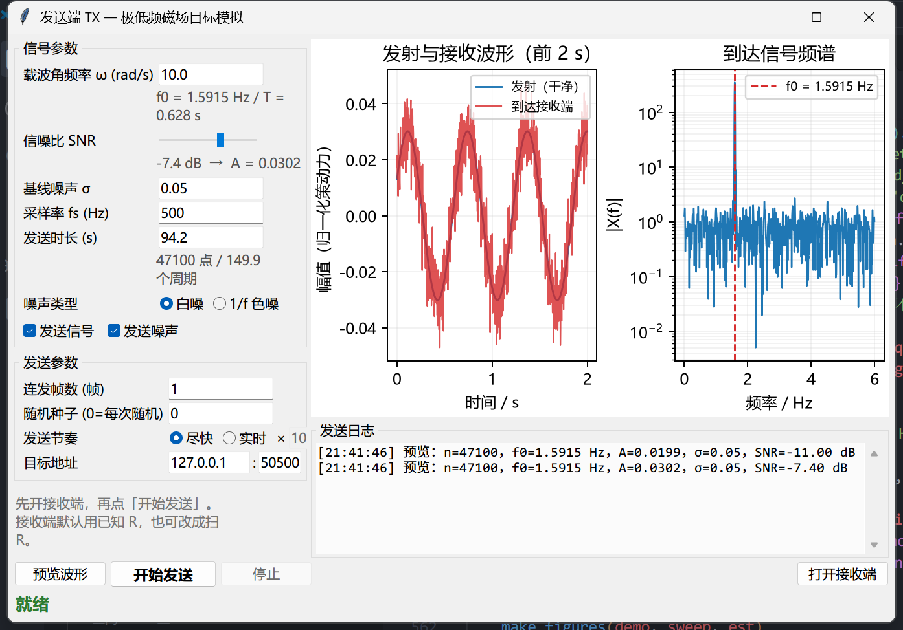
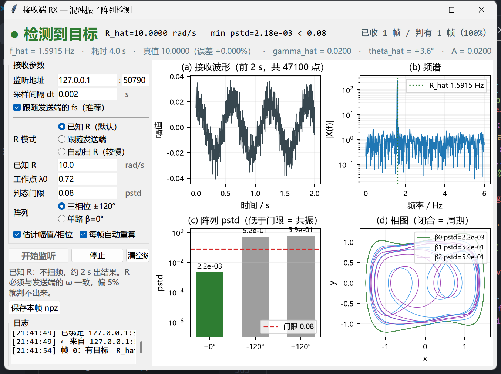

# 端到端双端 UI：发送端与接收端

前面几份文档都是"离线跑一遍出图"，**这一份是实时联调**：一个窗口发、另一个窗口收，点按钮就能看到判决。

- 发送端 `tools/tx_app.py`：模拟目标发出的极低频磁场，可独立开关**信号**与**噪声**，按 SNR 反算幅值。
- 接收端 `tools/rx_app.py`：监听、收帧、判「有/无目标」，显示**波形图**与**阵列图**。
- 两者共用 `tools/link_proto.py`（协议 + 算法），数值内核仍是 `kernel_src.simulate_seq`，**没有第二套积分器**。





---

## 一、启动方式

两个脚本各自独立运行，任一方先开后开都不影响（接收端先开更方便：可以看日志里"等发送端"的状态）。

```bat
:: 窗口 1：接收端（默认监听 0.0.0.0:50500，R 用已知值 10.0）
.venv\Scripts\python.exe tools\rx_app.py

:: 窗口 2：发送端（默认打向 127.0.0.1:50500）
.venv\Scripts\python.exe tools\tx_app.py
```

跨机联调时两头都要指定地址：

```bat
:: 接收端（在 192.168.1.20 上监听所有网卡）
.venv\Scripts\python.exe tools\rx_app.py --host 0.0.0.0 --port 50500

:: 发送端（从另一台机器发过去）
.venv\Scripts\python.exe tools\tx_app.py --host 192.168.1.20 --port 50500
```

发送端界面上还有个「打开接收端」按钮，会以子进程方式拉起 `rx_app.py` 并带上同一个端口号，省得手敲命令。

命令行参数一览（都很短，其余全在界面上）：

| 脚本 | 参数 | 默认 | 说明 |
|---|---|---|---|
| `tx_app.py` | `--host` | `127.0.0.1` | 目标地址 |
| | `--port` | `50500` | 目标端口 |
| `rx_app.py` | `--host` | `0.0.0.0` | 监听地址（填 0.0.0.0 收所有网卡） |
| | `--port` | `50500` | 监听端口 |
| | `--mode` | `known` | `known` 已知 R / `hint` 跟随发送端 / `auto` 盲测扫 R |

---

## 二、发送端参数

| 参数 | 默认 | 作用与约束 |
|---|---|---|
| 载波角频率 ω | 10.0 rad/s | 即 $f_0=1.5915$ Hz。接收端的 R 必须与它一致（或由它扫出来） |
| 信噪比 SNR | −11.0 dB | 滑块 −30…+5 dB。**幅值由它反算**：$A=\sigma\sqrt{2\cdot10^{\text{SNR}/10}}$ |
| 基线噪声 σ | 0.05 | 归一化策动力单位。噪声每样本标准差 $=\sigma\sqrt{\omega/f_s}$（力口径） |
| 采样率 $f_s$ | 500 Hz | 与接收端共享；收端默认"跟随发送端 fs" |
| 发送时长 | 94.2 s | 一帧的物理时长＝47100 点 ≈ 150 个载波周期。**低于 48 周期判据会抖**（见第七节） |
| 噪声类型 | 白噪 | 另可选 $1/f$ 色噪（去 DC 的一阶积分噪声） |
| 发送信号 | 开 | **独立开关**。关掉后只发噪声 → 用来做"无目标"对照 |
| 发送噪声 | 开 | 独立开关。关掉则是干净信号（$p_{std}$ 会低到 $10^{-3}$，无悬念） |
| 连发帧数 | 1 | 一次发 N 帧，接收端逐帧判决并累计 Pd/Pfa |
| 随机种子 | 0 | 0 = 每次随机初相；填定值可复现同一帧 |
| 发送节奏 | 尽快 | 尽快 = 包间 2 ms；实时 = 每包按 $\Delta t$ 停，可填倍率（如 ×10 就是 10 倍速） |
| 目标地址 / 端口 | 127.0.0.1 : 50500 | 与接收端一致 |

**为什么 SNR 与幅值是绑定的**：接收端判的是"驱动幅值有没有把振子推过阈值"，物理量是幅值 $A$；而工程上人们更习惯说信噪比。所以界面上让你调 SNR，程序内部换成 $A$ 再发给接收端——头包里两个都带，方便对表。

**信号与噪声两个开关要分开**，是因为它们回答不同的问题：

- 只开信号（无噪声）→ 检查判据的**物理正确性**（$p_{std}$ 该到 $10^{-3}$）；
- 只开噪声（无信号）→ 测**虚警率**（$p_{std}$ 该停在 0.4 以上，判「无」）；
- 都开 → 真实工况。

---

## 三、接收端参数

| 参数 | 默认 | 作用与约束 |
|---|---|---|
| 监听地址 / 端口 | 0.0.0.0 : 50500 | 与发送端一致 |
| 采样间隔 $\Delta t$ | 0.002 s | 勾「跟随发送端的 fs」时自动取头包里的 $1/f_s$（**推荐**） |
| R 模式 | **已知 R** | 三选一，见下 |
| 已知 R | 10.0 rad/s | 已知模式用。必须与发送端 ω 一致，**偏 5% 就判不出来** |
| 工作点 $\lambda_0$ | 0.72 | 与阶段 2–5 同一个工作点（比 $\lambda_c\approx0.7335$ 低 0.0135） |
| 判态门限 | 0.08 | $p_{std}$ 低于它算"该路共振"。混沌态约 0.4，周期态约 $10^{-3}$，中间没有含糊地带 |
| 阵列 | 三相位 ±120° | 三路或单路。三相位是为了补相位盲区（见第七节） |
| 估计幅值/相位 | 勾 | $\lambda^*$ 差分估计 $\hat\gamma$、$\hat\theta$，每帧多约 2.5 s |
| 每帧自动重算 | 勾 | 收到就自动算；取消则只记录不计算 |

### 三种 R 模式

用户明确说「可以已知 R，不用扫描 R」，所以默认走**已知 R**，扫 R 保留为论文的盲测流程：

| 模式 | 用时（47100 点） | 适用场景 |
|---|---|---|
| **已知 R**（默认） | **约 1.4 s**（含估幅约 4 s） | 联调、演示、已知目标频率的场合 |
| 跟随发送端 | 同上 | 联调最省事：不用两头各填一次，直接用头包里的 ω |
| 自动扫 R | 约 3.5 s | 论文流程：只拿序列与 $\Delta t$，FFT 粗估后在 ±1% 内两级细扫 |

已知 R 时仍然**不是"作弊"**：检测判决完全由 $p_{std}$ 与门限决定，R 只决定"在哪个时间尺度上看这个振子"。R 偏 5% 时驱动频率失谐到 1.05，共振塌掉、$p_{std}$ 从 $2.3\times10^{-3}$ 回到 $0.43$——这说明判决对 R 是敏感的，而**检测这件事本身仍然是靠动力学，不是靠对表**。

---

## 四、数据交互

### 4.1 为什么用 UDP 而不是共享文件

"一端发、一端收"要能跨进程、跨机器，还要能一帧一帧流式判。UDP 的好处是**不建立连接**：接收端先开就先听着，发送端后开也不会报错；发送端重启也不影响接收端。代价是可能丢包——这一点在 4.3 里专门处理。

### 4.2 包结构

统一 4 字节魔数 `WBDX` + 1 字节类型，三类包：

```
H 头包   WBDX H <UTF-8 JSON>
         字段：v, frame, n, fs, w_hint, amp, sigma, alpha,
               snr_db, has_sig, has_noise, duration, phase, ts
D 数据包 WBDX D <4s c I I I f> <float32[1024]>
         (magic, 'D', frame, seq, nseq, fs) + 1024 个样本 = 4117 字节
T 尾包   WBDX T <UTF-8 JSON>   {frame, sent, nseq}
```

一帧 = 1 个 H + $\lceil n/1024\rceil$ 个 D + 1 个 T。默认 $n=47100$ → 47 个数据包，整帧约 190 KB。

数据包选 1024 样本（4117 字节）是为了留足余量：单包不超过 MTU，跨机不会 IP 分片，丢一个包也只丢 1024 点。

### 4.3 接收端怎么装配

```
收到 H → 新建 FrameBuf(n)，按 seq 把 D 包写进定长数组
        ├─ 重复 seq 直接丢弃（回环/重传可能重复）
        ├─ 收够 n 点 或 收到 T → 提交给计算线程
        └─ 3 s 内没凑齐 → 丢弃残帧并报「缺 x 点」
```

缺包时**补零后仍然参与计算**并打警告——因为补零相当于"那段时间信号是 0"，会把 $p_{std}$ 抬高（偏保守，不会误判成"有"）。日志里会写明缺了多少点，便于判断这次判决可不可信。

### 4.4 时序

```
发送端                                 接收端
  │  H(n, fs, ω, A, SNR, 开关)  ────▶   新建帧缓冲
  │  D(seq=0..46, 1024 点/包)   ────▶   按 seq 填数组
  │  T(sent=n)                  ────▶   提交 → 计算线程（FFT/扫 R/阵列）
  │                                      ▼
  │                                   判决 + 画图（100 ms 内刷新界面）
```

发送端"尽快"模式下包间停 2 ms，一帧约 0.1 s 发完，但**接收端的计算要 1.4–4 s**。所以连发多帧时会在接收端排队——这是正常的，队列积压时界面会连续刷新好帧。

---

## 五、联调步骤

1. **先开接收端**，点「开始监听」。状态栏显示"监听中…"，日志出现"已绑定 0.0.0.0:50500，等待发送端…"。
2. **检查两端参数**：接收端 R 与发送端 ω 是否一致（都是 10.0）；接收端勾了"跟随发送端的 fs"就不会错。
3. **开发送端**，点「预览波形」确认 $f_0$、$A$、周期数都正常（周期数低于 48 会标黄/标红）。
4. **点「开始发送」**。接收端日志会出现"← 来自 127.0.0.1:xxxxx 帧 0，n=47100，fs=500.0，SNR=-11.0，信号=开 噪声=开"，然后 1–4 s 后出判决。
5. **做对照**：把发送端的「发送信号」取消勾选，再发一帧 → 接收端应判「未检测到目标」，$p_{std}$ 回到 0.4 以上。

判断联调是否正常，看三个数：**有目标时 min pstd 应在 $10^{-3}$ 量级、无目标时在 0.4 以上、门限 0.08 落在两者中间**。如果两端都在 0.4 以上，先查 R 是否填错；如果都在 $10^{-3}$，先查是不是关掉了噪声。

---

## 六、实测结果

条件：$\omega=10$、$f_s=500$、$\Delta t=0.002$、一帧 94.2 s（47100 点，150 周期）、$\lambda_0=0.72$、$\sigma=0.05$、$A=0.02$（−11 dB）。

| 场景 | 三路 $p_{std}$ | 判决 | 用时 |
|---|---|---|---|
| 有目标，$\theta=0$，已知 R=10 | **2.83e−03** / 5.02e−01 / 6.20e−01 | ✅ 有 | 4.1 s（含估幅） |
| 同一条帧，R 填成 10.5 | 4.26e−01 / 5.11e−01 / 5.88e−01 | ❌ 无 | 1.4 s |
| 纯噪声（信号关闭） | 4.45e−01 / 5.47e−01 / 6.64e−01 | ❌ 无 | 0.5 s |

- 已知 R 时频率误差 **+0.000%**（R 直接就是真值），幅值 $\hat\gamma=0.0200$、相位 $\hat\theta=+3.6°$。
- 三路里只有**正对相位的那一路**跌破门限，其余两路停在 0.5 上下——这正是三相位阵列"谁共振谁报警"的工作方式。
- 自动扫 R 时 $\hat R=9.9993$（误差 −0.007%），比已知 R 多花约 2 s。

---

## 七、已知边界与坑

**1. 帧长低于约 48 个载波周期，判据开始抖。** 实测（同相、5 个噪声种子）：

| 帧长 | 8 周期 | 16 周期 | 32 周期 | 48 周期 | 95 周期 | 150 周期 |
|---|---|---|---|---|---|---|
| $p_{std}$（有信号） | 0.42 | 0.32 | 0.31 | **1.8e−3** | 2.2e−3 | 2.3e−3 |
| 跨种子离散 | 0.026–0.54 | 0.14–0.51 | 1.7e−3–0.43 | 1.5e−3–0.48 | 稳定 | 稳定 |

原因是 `burn_frac=0.5` 丢掉前一半做瞬态，剩下的 Poincaré 点只有周期数的一半——16 周期只剩 8 个点算标准差，本身就不可靠。发送端界面因此在周期数 <60 时标橙、<30 时标红。

**2. 相位盲区：单振子会被"信号相位"封顶。** 相变由合成幅值 $\sqrt{\lambda_0^2+A^2+2\lambda_0A\cos\theta}$ 决定，$\lambda_0$ 只比 $\lambda_c$ 低 0.0135，所以 $A=0.02$ 时要求 $|\theta|<47.5°$——**单路覆盖率只有 26%，再大的 SNR 也救不回来**。三相位阵列把覆盖率补到约 79%，剩下的 21% 只能靠多发几帧。这也是"连发帧数"这个参数的用处。

**3. R 偏 5% 就判不出来。** 频率选择带宽只有 ±0.1%（阶段 2 实测），5% 远在带外。所以"已知 R"这条路要求 R 确实知道——联调时建议用"跟随发送端"，让包头把 ω 带过来。

**4. 参数改动即时生效，但只对**下一帧**。** 监听中改 R、$\lambda_0$、门限都会在下一帧生效（主线程每 100 ms 刷新一次参数快照），不用停止重开。

**5. 端口占用的处理。** 接收端绑定时设了 `SO_REUSEADDR` 与 4 MB 接收缓冲；如果 50500 被别的程序占了，日志会明确报"绑定失败"，换端口即可（记得发送端同步改）。

**6. 无板级实测。** 这套 UI 是**数值仿真链路**：发送端产生的是"归一化策动力单位"的序列，不是真实的磁通密度（pT）；$A$ 与 pT 的换算系数需要实测标定。界面上的"幅值"一律是同一套无量纲单位。

---

## 八、代码边界

| 文件 | 职责 | 与内核的关系 |
|---|---|---|
| `tools/link_proto.py` | 协议打包/解析、帧装配、信号生成、`analyze()` 全流程 | 只调 `simulate_seq`，无独立积分器 |
| `tools/tx_app.py` | 发送端界面与发送线程 | 不碰内核，只用 `make_frame` + `split_frame` |
| `tools/rx_app.py` | 接收端界面、接收线程、计算线程、四联图 | 不碰内核，只用 `analyze` |
| `tests/test_link_apps.py` | 14 项：协议往返、切包重组、UDP 环回、三种 R 模式、盲区、缺包统计 | 全部不启动 tkinter |

跑测试：

```bat
.venv\Scripts\python.exe -m pytest tests\test_link_apps.py -q
```

界面截图可用 `tools/shot_ui.py` 重新生成（它会给窗口置顶后按窗口外框截，避免被其他窗口盖住、或被 DPI 缩放截掉一半）。
