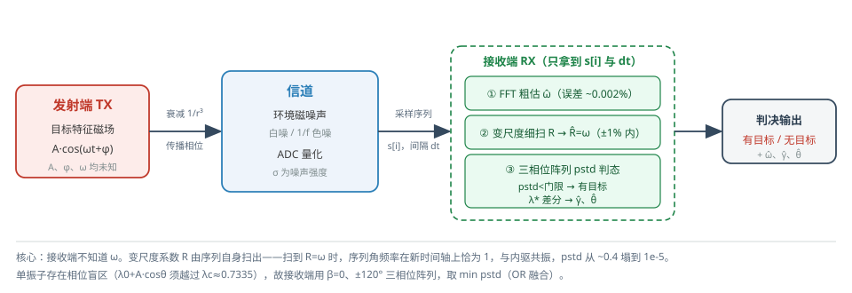
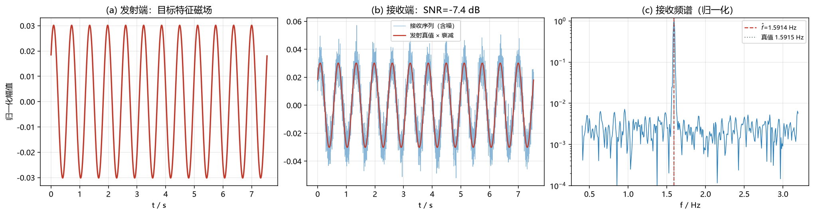
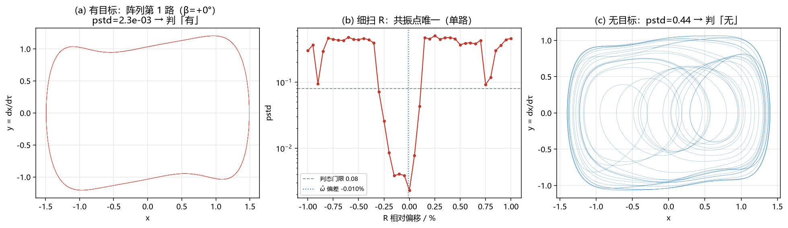
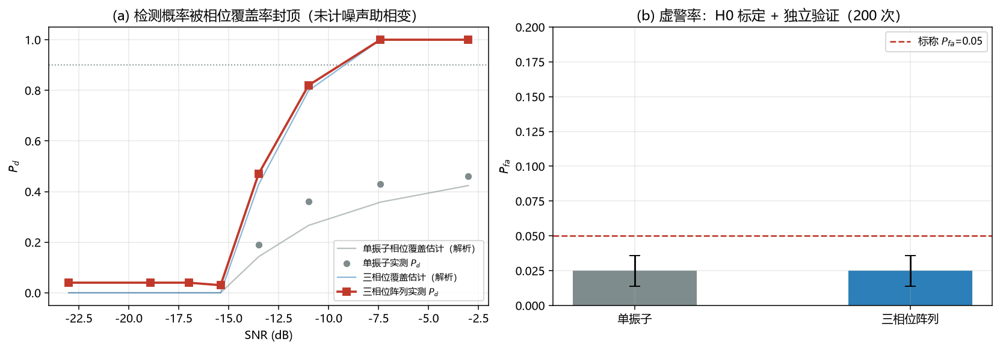
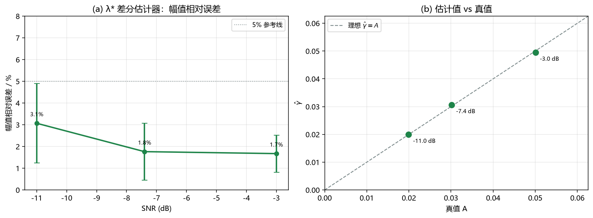

# 端到端链路仿真：一端发射、一端接收并识别目标

> **一句话结论**：用同一段 RK4 内核跑通「发射 → 信道 → 接收 → 判决」全链路。有目标时接收端把采样序列扫到 $R=\omega$ 共振，$p_{std}$ 从 0.44 塌到 $2.3\times10^{-3}$，判「有」；无目标时三路 $p_{std}$ 都在 0.44–0.56，判「无」。**频率估计误差 −0.010%**，**幅值误差 0.3%**（−7.4 dB）。三相位阵列在 **−7.4 dB** 达到 $P_d\ge0.9$，而单振子即便信号强到 −3 dB 也只有 **0.46**——限制它的是**相位盲区**，不是噪声。

> 代码：[`tools/link_sim.py`](../tools/link_sim.py)（约 500 行，命令行直接跑）；数字：[`复现输出/端到端链路-发射接收检测汇总.json`](../复现输出/端到端链路-发射接收检测汇总.json)。

---

## 一、为什么要做这条链路

阶段 2–5 各自回答了局部问题：振子怎么建模、阈值在哪里、含噪能不能检测、定点化掉不掉精度。但它们都默认"**接收端手里已经有一段准备好的序列**"。真实系统里这段序列要由发射端发出、经信道衰减和噪声污染、被接收端采样得到，中间任何一环参数错，后面全错。

这条链路补的就是这一段，并且把三件事一次性串起来验证：

| 环节 | 验证什么 | 对应阶段 |
|---|---|---|
| 发射端 → 信道 → 接收端 | 频率未知时能否自己找到 $\omega$ | 阶段 2（变尺度） |
| 接收端判决 | 有噪、初相随机时能否判「有/无」 | 阶段 3、4（判据与 Pd） |
| 幅值/相位估计 | 判「有」之后能否给出数值 | 阶段 4（$\lambda^*$ 差分器） |



---

## 二、链路模型与参数

### 2.1 三段各做什么

**发射端**：目标特征磁场，单频连续波。

$$s_{tx}(t)=A\cos(\omega t+\varphi)$$

$A$、$\varphi$、$\omega$ 对接收端**全部未知**——这是与阶段 4 最大的区别（那里 $\theta$ 固定为 0）。

**信道**：衰减 + 加性噪声 + 量化。

$$s_{rx}[i]=\underbrace{A\cdot10^{-\alpha_{dB}/20}\cos(\omega i\Delta t+\varphi)}_{\text{信号}}+\underbrace{\sigma\sqrt{h_1}\,n[i]}_{\text{环境磁噪声}}+\underbrace{q(\cdot)}_{\text{ADC}}$$

噪声口径沿用阶段 1/4：**每步标准差 $\sigma\sqrt{h_1}$**，$\sigma$ 是力强度，不是样本标准差。$h_1=R\Delta t$ 是数值步长，不是采样间隔。

**接收端**：三步盲处理。

1. **FFT 粗估**：Hann 窗 + 8 倍补零 + 对数幅度抛物线插值，只在"目标特征频段"（$0.5f_0\sim1.5f_0$）内找峰。
2. **变尺度细扫**：在 $\hat\omega_0$ 的 ±1% 内以 0.05%/格 扫 $R$，取 $p_{std}$ 最小点。**只用单路（β=0）**——三路取 min 会把别的振子的伪相变捞进来，把带宽边界弄糊。
3. **判态与估计**：三相位阵列 $p_{std}$ 取 min，低于门限即判「有」；再用 $\lambda^*$ 差分器估 $\gamma$、$\theta$。

### 2.2 参数表

| 量 | 值 | 说明 |
|---|---|---|
| 载波 $f_0$ | 1.5915 Hz | $\omega=10$ rad/s，落在极低频段 |
| 采样率 | 500 Hz | $\Delta t=0.002$ s |
| 数值步长 $h_1=R\Delta t$ | 0.02 | 与阶段 2–4 的 $h=0.02$ 完全一致，阈值可直接对照 |
| 观测窗 | 150 个载波周期 = 94.2 s | 47124 点 |
| 工作点 $\lambda_0$ | 0.72 | $\lambda_c\approx0.7335$，留 0.0135 裕度 |
| 噪声 $\sigma$ | 0.05 | 全扫描固定，只扫信号幅值（阶段 4 的正确做法）|
| SNR 口径 | $10\lg[(A^2/2)/\sigma^2]$ | 整段能量比，与阶段 1/4 同口径 |

**链路预算**（近场磁偶极 $B=\frac{\mu_0}{4\pi}\frac{m}{r^3}$，每 ×10 距离 −60 dB）：$r=1$ m 记 0 dB 时，10 m 为 −60 dB、100 m 为 −120 dB。示例 $m=100$ A·m²（2000 匝、1 A、0.05 m²）对应 $r=10$ m 约 0.1 nT、$r=100$ m 约 0.1 pT。

> **边界**：归一化幅值 $A$ 与绝对磁感应强度之间的换算系数 $B_{ref}$ 需实测标定，本仿真只做**幅值比**，不作绝对灵敏度断言。

---

## 三、接收端为什么必须"盲"

核心只有一句：**接收端不知道 $\omega$，也不许预设 $\nu$**。

变尺度系数 $R$ 的作用是把物理采样间隔 $\Delta t$ 映射成数值步长 $h_1=R\Delta t$。序列里角频率为 $\omega$ 的分量，在新时间轴 $\tau=i h_1$ 上变成 $\cos(\omega\tau/R)$——**只要 $R=\omega$，它就等于内驱的 $\cos\tau$**，两者共振，振子从混沌跃迁到大尺度周期，$p_{std}$ 塌下去。

于是"测频"变成了"扫 $R$ 找相变点"，而那一点的 $R$ 就是 $\omega$：

```python
w0 = fft_guess(cfg, rx)                       # 只用序列和 dt
grid = w0 * (1 + np.arange(-20, 21) * 0.0005) # ±1%，0.05%/格
vals = [pstd_batch(cfg, rx[:, :1], R)[0] for R in grid]
R_hat = grid[np.argmin(vals)]                  # 相变点 = 待测频率
```

**为什么不能全域穷举**：频率选择带宽只有 ±0.1%（阶段 2 实测，三频一致）。若在全域按 4.9%/格 粗扫，离真值最近的格点已偏 0.88%，$p_{std}$ 停在 $1.4\times10^{-2}$——那是伪相变，不是共振。必须先让序列自己给出初值（FFT 误差 ~0.002%），再在小窗内细扫。



上图中 (b) 是接收端真正拿到的波形：SNR = −7.4 dB，肉眼几乎看不出正弦，但 (c) 的频谱峰依然清晰落在 1.5915 Hz。

---

## 四、单次判决：有目标 vs 无目标

同一台接收机，同一组参数，只改"发射端开不开"：

| | 三路 $p_{std}$（β=0° / −120° / +120°） | min $p_{std}$ | 判决 |
|---|---|---|---|
| **有目标**（SNR=−7.4 dB，φ=−52.2°） | 0.00233 / 0.479 / 0.609 | $2.3\times10^{-3}$ | ✅ 有 |
| **无目标**（只有噪声） | 0.439 / 0.492 / 0.564 | 0.439 | ✅ 无 |

判态门限由 H0 标定：200 次纯噪声的 5% 分位数为 **0.347**，落在混沌态的 $p_{std}$ 带（0.33–0.48）下沿，与周期态的 $10^{-3}$ 量级差 **两个多数量级**，判决没有含糊地带。



- (a) 有目标：大尺度周期轨道，$p_{std}=2.3\times10^{-3}$；
- (b) 细扫 $R$：共振点唯一且尖锐。**注意两侧 ±0.75% 处的伪共振**（$p_{std}$ 掉到 ~0.1 又弹回），它们仍在门限之上；这正是"带宽只有 ±0.1%"的直观证据；
- (c) 无目标：混沌轨迹填满相空间，$p_{std}=0.44$。

频率估计误差 **−0.010%**（真值 10 rad/s，估计 9.9990），远小于 ±0.1% 的带宽，够用。

---

## 五、检测性能：真正的限制是相位，不是噪声

固定 $\sigma=0.05$、扫信号幅值，每个 SNR 做 100 次（每次重抽噪声与初相），门限一次性由 200 次 H0 标定、再用**另一批** 200 次 H0 验证：

| SNR (dB) | −23 | −18.9 | −17 | −15.4 | −13.5 | −11 | **−7.4** | −3 |
|---|---|---|---|---|---|---|---|---|
| 单振子 $P_d$ | 0.04 | 0.04 | 0.04 | 0.03 | 0.19 | 0.36 | 0.43 | 0.46 |
| 三相位阵列 $P_d$ | 0.04 | 0.04 | 0.04 | 0.03 | 0.47 | 0.82 | **1.00** | 1.00 |

$P_{fa}$（独立验证集 200 次）：单振子 **0.025**、阵列 **0.025**（标称 0.05，偏保守来自 5% 分位数的抽样误差）。



### 5.1 单振子为什么"再强的信号也只有一半"

相变由**合成幅值**决定。共振时信号与内驱同频，合成幅值

$$\lambda_{eff}=\sqrt{\lambda_0^2+A^2+2\lambda_0A\cos\theta}$$

必须越过 $\lambda_c\approx0.7335$。$\lambda_0=0.72$ 只差 0.0135，于是要求

$$\cos\theta>\frac{\lambda_c^2-\lambda_0^2-A^2}{2\lambda_0A}$$

$A=0.02$ 时阈值是 $\cos\theta>0.675$，即 $|\theta|<47.5^\circ$——**相位覆盖只有 26%**。$A=0.05$ 时也只到 42%。

这就是图中灰线（解析覆盖估计）的含义：**$P_d$ 的上限由初相覆盖率决定，与噪声无关**。实测点略高于灰线（−11 dB 时 0.36 vs 0.27），因为噪声会"帮"系统越过阈值——这也解释了为什么这条曲线不随 SNR 平滑上升，而是被压在半高。

### 5.2 三相位阵列把盲区补上

$\beta=0,\ \pm120^\circ$ 三个振子各自覆盖一段 $\pm\theta_h$，取 min $p_{std}$（OR 融合）。$A=0.02$ 时每段 $\pm47.5^\circ$、三段合计 285°，覆盖 79%；$A\ge0.03$ 时三段拼满一圈，覆盖率 100%。

实测与解析吻合到 0.02–0.04：−11 dB 阵列 0.82（解析 0.80），−7.4 dB 起 1.00。

**结论**：三相位阵列的最低可检测 SNR（$P_d\ge0.9$）= **−7.4 dB**；单振子在整条扫描上都没到 0.9。

### 5.3 与阶段 4 的 −11 dB 怎么对上

阶段 4 报"单振子 −11 dB，$P_d=0.96$"，条件里 **$\theta$ 固定为 0**——那是同相的理想条件，等价于覆盖 100%。链路里发射端相位不可控（−52.2°、57° 都可能），单振子立刻被压到 0.36，必须靠阵列补回来。

**两个数字都对，但口径不同**：一个是"相位已知"的上界，一个是"相位随机"的实际。论文里引用时必须带条件，不能只写"−11 dB"。

---

## 六、判「有」之后：幅值与初相

$\lambda^*$ 差分估计器：四个参考相位各扫到相变点 $\lambda^*(\beta)$，再作差消掉 $\lambda_c$：

$$\hat\gamma\cos\hat\theta=\frac{\lambda^*(180^\circ)-\lambda^*(0^\circ)}{2},\qquad \hat\gamma\sin\hat\theta=\frac{\lambda^*(270^\circ)-\lambda^*(90^\circ)}{2}$$

每个 SNR 重复 5 次（每次随机初相）：

| SNR (dB) | 真值 $A$ | $\hat\gamma$ 均值 | 幅值相对误差 | 相位误差 |
|---|---|---|---|---|
| −11.0 | 0.0199 | 0.0200 | **3.1%** | 2.9° |
| −7.4 | 0.0302 | 0.0307 | **1.8%** | 1.3° |
| −3.0 | 0.0501 | 0.0496 | **1.7%** | 0.4° |



与阶段 4 的 3.8–5.8% 同量级、略好，因为观测窗更长（150 个载波周期，阶段 4 是 64 周期）——$\lambda^*$ 的相变点因为瞬态被丢得更干净而更陡。

---

## 七、四个必须写进论文的边界

1. **无板级实测**。全部是数值仿真。发射/接收是"同一台计算机的两端"，没有真实线圈、磁强计、放大器。
2. **绝对灵敏度未标定**。$A$ 是归一化策动力，与 pT/nT 的换算需要 $B_{ref}$ 实测。链路预算只给 $1/r^3$ 的**相对**衰减。
3. **噪声是加性的、平稳的**。真实环境有工频干扰、脉冲噪声、传感器漂移；本仿真只覆盖白噪与 1/f 色噪。
4. **单目标、单频、连续波**。没有多目标、跳频、调制；目标特征频率被假定在已知的窄带内（$0.5f_0\sim1.5f_0$）。

另外两条方法学提醒：

- **$P_{fa}$ 用独立验证集**。门限由 200 次 H0 标定，另取 200 次 H0 验 Pfa，避免"同一批既标定又验证"的乐观估计（阶段 4 的隐患）。
- **位宽不是瓶颈**。同一段数据量化到 8/12/16 bit，$p_{std}$ 分别为 $2.26\times10^{-3}$ / $2.22\times10^{-3}$ / $2.22\times10^{-3}$——与阶段 5 的结论一致：$\ge$12 bit 后判决不受影响，掉精度的是 F≤8。

---

## 八、怎么跑

```bat
.venv\Scripts\python.exe tools\link_sim.py            :: 全量，约 95 s
.venv\Scripts\python.exe tools\link_sim.py --quick    :: 冒烟，约 35 s
```

输出：

| 文件 | 内容 |
|---|---|
| `复现输出/端到端-发射与接收.png` | 发射波形、含噪接收波形、接收频谱 |
| `复现输出/端到端-相图与频率扫描.png` | 阵列最佳路的相图、细扫 $R$ 曲线、无目标相图 |
| `复现输出/端到端-Pd与Pfa.png` | $P_d$–SNR（实测 + 解析覆盖）+ $P_{fa}$ |
| `复现输出/端到端-幅值估计.png` | 幅值相对误差–SNR |
| `复现输出/端到端链路-发射接收检测汇总.json` | 全部条件与数字（含 SNR 口径、门限、试验次数）|

脚本不 import 阶段 2–5 的 notebook，只从 `tools/kernel_src.py` 取 `simulate_seq` 的源码——**与那几份 notebook 是逐字相同的内核**，所以这里的阈值、判据、动态范围都能和阶段 2–4 直接对照。
