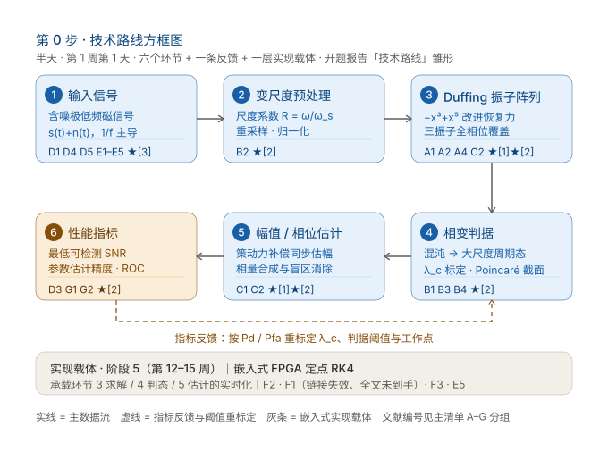
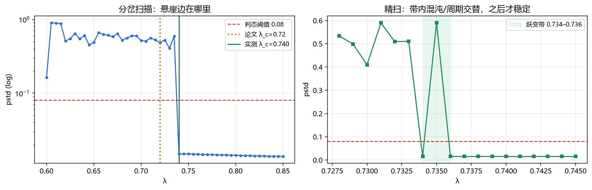
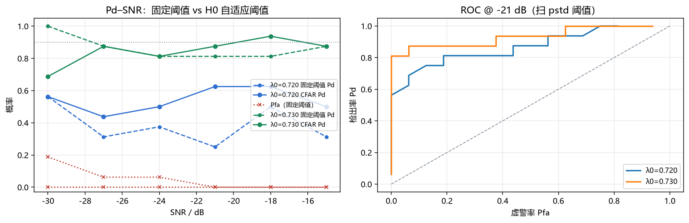
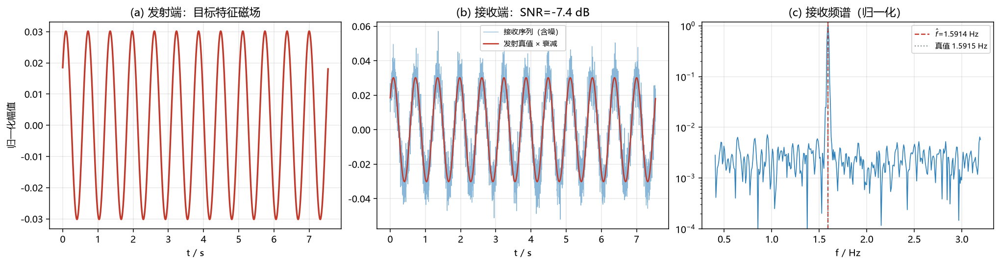
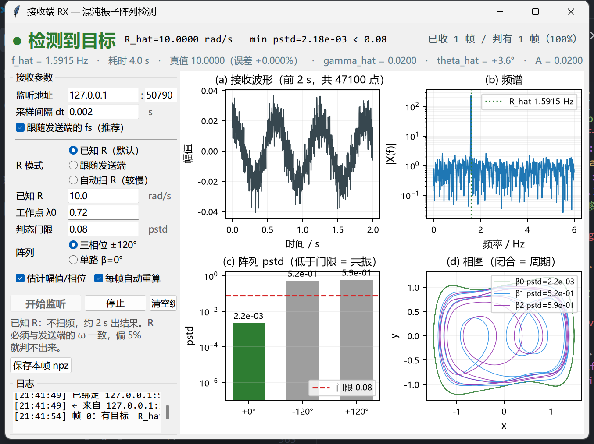

# 基于混沌振子的极低频磁场微弱信号检测

> 本科毕业设计（工程设计类）· 华中科技大学集成电路学院 · 指导教师：欧阳君
>
> 一个把「**理论建模 → 数值复现 → 判决判据 → 性能评估 → 嵌入式实现 → 端到端联调**」走通的极低频磁场微弱信号检测项目。仓库既是毕设交付物，也是一套可运行、可复现、带完整文献与数值记录的研究档案。



---

## 一眼看懂

| 维度 | 内容 |
|---|---|
| **研究对象** | 强噪声背景下的极低频（~Hz 级）微弱磁场信号 |
| **核心方法** | Duffing 混沌振子 + 变尺度 + 相变判据；三振子相位阵列补盲区 |
| **最低可检测 SNR** | **−11.0 dB**（Pfa ≤ 0.05、Pd ≥ 0.9、白噪/1/f、T = 400 s、`SNR_E` 口径、θ = 0 同相条件） |
| **幅值估计误差** | 白噪 4.2–5.0% / 色噪 7.4–8.8%（γ = 0.02，λ* 差分器） |
| **临界阈值 λ_c** | ≈ **0.7335**（带：0.7332 混沌 / 0.7336 周期；报带不报点） |
| **端到端盲测** | FFT 初值 + ±1% 细扫，频率误差 ≤ 0.012%；三相位阵列 −7.4 dB 下 Pd = 1.00 |
| **工程载体** | ESP32 定点化规格（Q2.F，F = 12 可烧录）；UDP 双端 GUI 实时联调 |
| **数值内核** | 单一源码、浮点与定点同签名；优化后判一帧 **1.5 s → 0.15 s（10×）**，黄金样本逐位一致 |
| **验证状态** | `pytest tests -q` → **111 passed, 0 failed**；本地引用 **954 条，0 失效** |

> 所有指标都带条件。SNR 门限、阈值、带宽、覆盖率若脱离条件横向比较会失真，详见 [00-总览/阅读路线.md](00-总览/阅读路线.md) 与各阶段过关页。

---

## 关键结果

**相变判据与阈值扫描**（混沌态 ↔ 大尺度周期态，临界区锁定在 0.7335 附近）：



**检测概率 — 信噪比曲线与 ROC**：



**端到端链路**（发射 → 1/r³ 衰减 + 噪声 → 接收端 FFT 粗估 + 变尺度细扫 + 三相位判决）：



完整的 40+ 张实跑图、8 份 JSON 数值汇总在 [`复现输出/`](复现输出/)；主交付复现 notebook 见 [`复现-2-混沌振子建模与临界阈值.ipynb`](复现-2-混沌振子建模与临界阈值.ipynb)（25 单元、10 图、已实跑内嵌输出）。

---

## 目录导航

文档按「主题 + 阶段」归入 9 个编号目录，代码、数据、文献分层管理：

| 目录 | 看什么 |
|---|---|
| [00-总览](00-总览/) | **从这里开始**：[阅读路线](00-总览/阅读路线.md)、[项目结构说明](00-总览/项目结构说明.md)、[技术路线方框图](00-总览/第0步-技术路线方框图.md)、[环境说明](00-总览/环境说明-跑ipynb.md)、[性能优化与基准](00-总览/性能优化与基准.md) |
| [01-阶段一](01-阶段一/) | 文献解读、现状综述草稿、信号与噪声模型假设、问题清单 |
| [02-阶段二](02-阶段二/) | 建模与相变、RK4 仿真、阈值带、ν/R 辨析 |
| [03-阶段三](03-阶段三/) | 判据对比、临界点 γ_c、初相位盲区 |
| [04-论文精读](04-论文精读/) | 4 篇核心论文的逐节精读卡 |
| [05-方法创新](05-方法创新/) | 阈值位移符号判别、相变边界追踪、边界条件、创新点对比 |
| [06-阶段四](06-阶段四/) | 含噪检测、Pd/Pfa、参数估计、两项指标兑现 |
| [07-阶段五](07-阶段五/) | 定点化与资源时序、ESP32 固件规格 |
| [08-端到端链路](08-端到端链路/) | 发射—接收—判决全链路、双端 UI 联调说明 |
| [learn](learn/) | 6 份教学 notebook（`0`–`5.ipynb`），逐阶段可运行实验 |
| [tools](tools/) | 源码与运行链：唯一内核、notebook 生成器、链路仿真、双端 GUI、基准测试 |
| [tests](tests/) | 111 项测试，含 13 项逐位黄金样本 |
| [复现输出](复现输出/) | 程序生成的 40+ 图与 8 份 JSON 汇总 |
| [文献](文献/) | 19 篇全文 PDF、`参考文献.bib`（GB/T 7714—2015）、[下载索引](文献/00-下载索引.md) |
| [c2-jupyterbook](c2-jupyterbook/) · [s2-jupyterbook](s2-jupyterbook/) | 两套 Jupyter Book 完整复现工程及构建成品 |

📄 **开题报告成稿**：[开题报告-基于混沌振子的极低频磁场微弱信号检测.docx](开题报告-基于混沌振子的极低频磁场微弱信号检测.docx)（封面按官方模板、参考文献 16 条全部可在 `文献/` 找到全文）

---

## 快速开始

> 环境：Windows + Python 3.13。依赖版本已锁定在 [`requirements.txt`](requirements.txt)，**不要随意升级 numpy / matplotlib**，否则复现数值会漂移。

### 1. 看文档站点（推荐入口）

双击根目录的 `start_index.bat`：它会重建静态副本、在 `127.0.0.1:8765` 起本地服务并打开浏览器。也可以直接双击 `index.html` 离线浏览。

手工方式：

```bat
py tools\build_static.py      :: 改过 Markdown 后重建同名 .html 副本
py tools\serve_index.py 8765  :: 起服务，浏览器打开 http://127.0.0.1:8765/index.html
```

### 2. 复现实验

```bat
:: 建虚拟环境并装依赖（首次）
py -m venv .venv
.venv\Scripts\python.exe -m pip install -r requirements.txt -i https://pypi.tuna.tsinghua.edu.cn/simple

:: 交互跑 notebook
start_notebook.bat

:: 无界面重跑主交付 notebook（输出写回 + 图写入 复现输出/）
run_ipynb.bat

:: 端到端链路仿真（约 95 s，出 4 图 + JSON）
.venv\Scripts\python.exe tools\link_sim.py --quick
```

### 3. 跑测试与性能基准

```bat
.venv\Scripts\python.exe -m pytest tests -q
.venv\Scripts\python.exe tools\bench_speed.py
```

### 4. 双端实时联调（可选）

```bat
.venv\Scripts\python.exe tools\rx_app.py --mode known   :: 接收端（默认已知 R，不扫频）
.venv\Scripts\python.exe tools\tx_app.py               :: 发送端
```



---

## 研究纪律与口径

项目在反复复现中形成几条硬口径，改数值前请先读：

- **ν 不是自由参数**，是 `ω/R` 的别名；待测 ω 未知时扫 R 到相变点即可，该点的 R 就是 ω。
- **阈值报带不报点**：λ_c ≈ 0.7335 是刀锋区，0.7332 混沌 / 0.7336 周期。
- ** Poincaré 采样必须精确落在 τ = 2πk 做线性插值**；按步数取整会把周期态 pstd 抬高 3.5 个量级。
- **带宽只有 ±0.1%**，且测量必须单路 β = −120°；三振子取 min 会把伪相变捞进来。
- **SNR 门限必须连 Pd/Pfa 与条件一起给**；不同文献的 −21 / −18 / −12 dB 实验条件不同，不可直接横比。
- **内核唯一来源**是 [`tools/kernel_src.py`](tools/kernel_src.py)：浮点与 Q2.F 定点同签名，各 notebook 自包含拼接而成。改内核只能改这一处，并用黄金样本逐位校验。

完整的数值定论、踩坑记录与优化推导见 [00-总览/性能优化与基准.md](00-总览/性能优化与基准.md) 与 [项目结构说明·关键路径锚点](00-总览/项目结构说明.md)。

---

## 文献与规范

- **19 篇全文 PDF** 已入库，编号见 [`文献/00-下载索引.md`](文献/00-下载索引.md)，题录按 GB/T 7714—2015 存于 [`文献/参考文献.bib`](文献/参考文献.bib)。
- 开题报告的 16 条参考文献**逐条可在 `文献/` 找到本地全文**。
- 华中科技大学本科毕业设计（论文）工作管理办法及附件 1–5 存于 `文献/`，作为版式与格式依据。

---

## 许可与说明

本项目为本科毕业设计研究档案，代码与文档供学习、复现与交流使用。文献 PDF 版权归各自出版方所有，仅用于学术研究。第三方库（numpy、matplotlib、Jupyter 生态）按其各自许可证分发。

---

> 📌 想快速定位任何内容，先打开 [阅读路线](00-总览/阅读路线.md) 与 [index.html](index.html)；两者的入口卡片覆盖全部核心文档。
